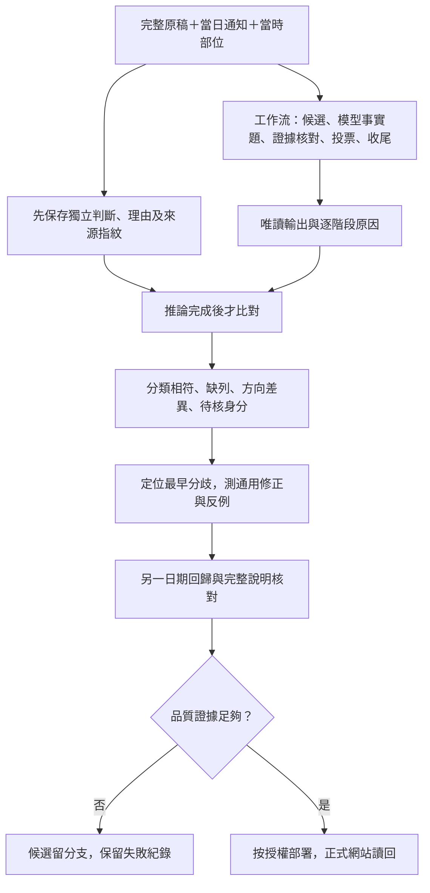
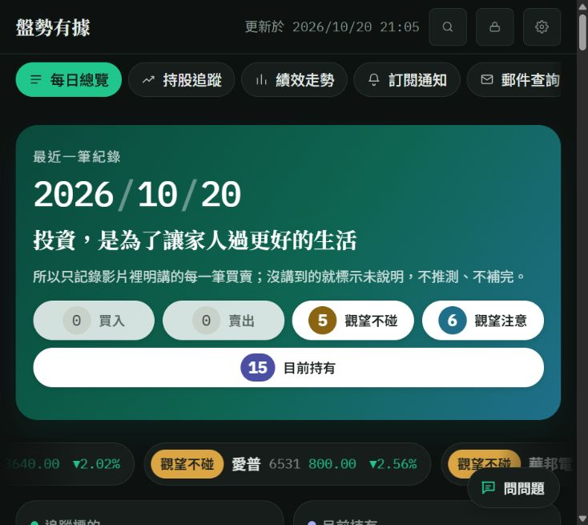
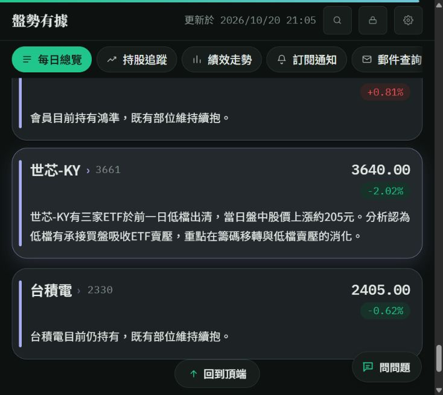
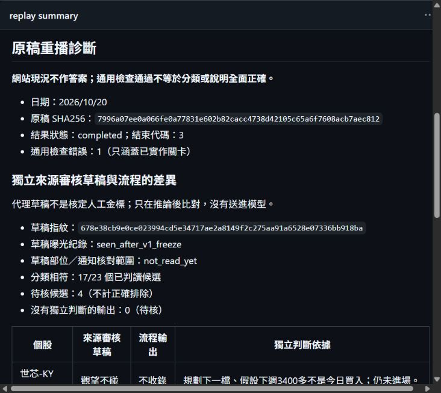

# 2026/10/20：正式修復、歷史回歸與裁決分歧

## 驗收範圍與證明界線

先完整閱讀原稿、保存獨立分類草稿，再比較工作流；正式站只驗證發布結果，不作分類答案。今天原稿13,541字，影片 `MLOiLNJBiEw`，SHA256 `7996a07ee0a066fe0a77831e602b82cacc4738d42105c65a6f7608acb7aec812`。9/18原稿25,152字，來源 `MANUAL-20260918`，SHA256 `0ffae69dcccc1b5323661dac774608dad2672b7d4f09ad48cdaf3a26f694c243`；其中逐字間空白只在閱讀時移除，保存原始指紋。

兩天都沒有既有核定答案檔。10/20盤點27候選、9/18盤點23候選，包含不公開及身分未定項目。這是代理依來源作的獨立審核草稿，不是人類金標。10/20初稿將達邁代號誤填3491，名錄核對後改3645；v1保留，v2記錄更正，不能隱藏審核者自己的錯誤。沒有將草稿注入真實重播。

## 一、今日正式資料已修復

當日後台通知原文要求等待與續抱，沒有個股成交指令。正式修復以原文、當時部位及列指紋為依據，17筆變更（9更新、8新增），不是等待模型碰巧生成正確版本。

| 公開分類 | 正式讀回 |
|---|---|
| 買入／賣出 | 各0筆 |
| 今日提及持股7檔 | 達邁、毅嘉、祥碩、嘉澤、瑞鼎、力積電、鴻準 |
| 觀望注意6檔 | 群聯、台積電、聯電、世界、宜鼎、鴻海 |
| 觀望不碰5檔 | 國巨、南亞科、世芯-KY、愛普、華邦電 |

首頁「目前持有15」是整體未出場部位，不是今日提及持股數7。兩種數字用途不同，不把15改成7。

正式修復：`scripts/repairs/2026-10-20-source-review.json`。第一次預覽因引句「瑞鼎。」太短被擋，修正引用範圍後再預覽，沒有降低引句門檻。預覽 [39390152258](https://github.com/Lee200202/Stock/actions/runs/39390152258) 通過；正式套用 [39390313237](https://github.com/Lee200202/Stock/actions/runs/39390313237) 成功。三張工作表先備份，寫入後讀回、郵件查詢／持股／績效刷新均通過；其他日期、通知來源、已寄旗標及Email／LINE帳本未變。

正式首頁、郵件查詢與後台均已讀回。16:00的首頁快照在16:03寫入後短暫仍舊，16:05背景刷新後一致；晚間21:05再次讀回仍為上述分類。不是只驗收套用日誌綠燈。已寄出的信件不會隨網站變動；本輪沒有重寄。

## 二、漏收與誤收必須一起檢查

| 情境 | 來源判斷 | 已觀察到的流程分歧 | 所需界線 |
|---|---|---|---|
| 世界、聯電「不准殺低」 | 正面續抱建議，沒有講者部位時列注意 | 把禁止出場讀成禁止進場；或因前瞻詞表沒命中而剔除 | 動作方向與進場立場分軸，不能看到「不准」便列不碰 |
| 宜鼎回到年線 | 上文明講回年線可佈局，再確認本股符合 | 引用區只留下沒有持有，遺失共同條件 | 保留前文供理解；共同條件需明示本股適用，不能借前股EPS或價格 |
| 華邦電、南亞科 | 同被說明短線當沖反覆、不參與 | 股名切段只保留最後一檔或單獨點名 | 並列名單的共同結論需對兩檔各自核對；各講各的不能共用 |
| 台積電 | 有季線評估與法人承接的正面現況 | 持股／注意／注意被視為三票互相反對，晚補列因此消失 | 正面看法與實際部位分軸；法人持股不證明講者持有 |
| 鴻海 | 歷史出場之外另有今日240元附近支撐看法 | 只因曾賣出便當回顧 | 歷史事件不能遮蔽另有依據的今日觀點 |
| 國巨、世芯-KY | 今天仍明講條件未到、未進場 | 未來可能買回有時被當現在可以買 | 未來規劃不覆蓋目前禁令，不建立今日成交 |
| 大量、未具名圖、比較用股票 | K棒術語／身分不明／僅對照 | 擴大上下文可能把它們誤收 | 完整原稿能幫理解，不能讓每句話變成每檔可引用的證據 |

**放寬的是可被核實的語意範圍，並非增加檔數。** 同時保留：純行情不等於向前看法、觀眾／法人不是本人、推薦不等於成交、過去交易不等於今天交易、別股數字不屬於本股。未定項目單獨列出，不靜默算成正確排除。

## 三、為何多問AI仍可能失敗

1. **證據傳輸錯誤**：模型將聽打原字「連電」正名為「聯電」，引句就不再逐字符合原稿。分類可能理解正確，證據核對仍拒收。解法是程式先為原句編號，模型選編號，程式取回原字；公開說明另作正名。
2. **可引用範圍錯誤**：問卷看到全文，不代表可以引用的範圍正確。宜鼎買點在前文，並列股票結論又被切段，模型無法提供允許的證據。應分開「理解背景」與「本股證明」，不能直接把全文授權成任何股票的引句。
3. **事實軸混合**：「沒有持有」不是「沒有正面看法」；持股與注意可同組驗收，不代表可虛構持股。要另外核對持有者及進出場方向。
4. **後續生成重寫**：分類對了，說明仍可能借用鄰股技術或把漲幅當股價。增加一個自評Prompt也未必擋得住，必須拿真實錯誤驗證，不以模型說通過作證。
5. **投票的共同盲點**：三輪模型可能重複同一個輸入範圍錯誤。票數不是機率保證；應先修輸入及定義，不能用更多套用重擲。

## 四、真實模型重播帳

全部唯讀、停用人工與模型裁決快取，未注入分類答案與核對說明。仍讀目標日通知、日期以前部位及名稱備忘；這些上下文沒有跨run凍結，不宣稱嚴格成對A/B的因果提升、統計顯著或人類金標準確率。失敗與重試保留。

| run | 日期／版本 | 請求 | 通用檢查與實際審核 |
|---|---|---:|---|
| [39391616194](https://github.com/Lee200202/Stock/actions/runs/39391616194) | 10/20，469daf1 | 15 | 失敗，愛普漏收；較大事實協定原型未採用 |
| [39392228588](https://github.com/Lee200202/Stock/actions/runs/39392228588) | 10/20，6581396 | 18 | 失敗，仍漏收，不合併 |
| [39392842130](https://github.com/Lee200202/Stock/actions/runs/39392842130) | 9/18，53f411b | 15 | 失敗；聯電正名改了原句，證據不合法 |
| [39424324710](https://github.com/Lee200202/Stock/actions/runs/39424324710) | 9/18，43be94b | 14 | 通用檢查過，但仍有漏項與說明跨股；不算內容通過 |
| [39424907221](https://github.com/Lee200202/Stock/actions/runs/39424907221) | 9/18，f8f80ba | 19 | 新說明核對仍漏掉世芯價位／漲停及祥碩跨股內容；該實驗已撤回 |
| [39425870611](https://github.com/Lee200202/Stock/actions/runs/39425870611) | 10/20，d4b1737 | 17 | 失敗；漏宜鼎、台積電、華邦電、南亞科，世界錯列不碰 |
| [39428360100](https://github.com/Lee200202/Stock/actions/runs/39428360100) | 10/20，b46318b | 15 | 失敗；只保留10檔，八檔漏收、愛普方向錯誤，不採用 |
| [39430181888](https://github.com/Lee200202/Stock/actions/runs/39430181888) | 10/20，9452656 | 15 | 通用檢查過，六檔注意均保留；仍漏華邦電、南亞科、世芯，不算內容通過 |
| [39431739641](https://github.com/Lee200202/Stock/actions/runs/39431739641) | 10/20，babfc91 | 19 | 通用檢查過；衝突補核收回世芯，但仍漏兩檔、愛普被直接規則錯列注意；不採用 |
| [39435719008](https://github.com/Lee200202/Stock/actions/runs/39435719008) | 10/20，27b445c | 17 | 失敗；兩輪事實題MAX_TOKENS截斷，獨立草稿23個已判讀候選相符17項，六檔漏收；不採用 |

上述十輪164次邏輯模型呼叫；同一呼叫內HTTP重試總數未完整保存，不能冒稱164為所有HTTP嘗試。設定滾動上限15RPM，串行測試；平均每分鐘次數不能證明跨系統峰值，正式來源修復0次模型請求、0次寄送。

候選新版本 `b46318b` 在隔離分支 `codex/1020-verdict-boundaries`，不是正式每日流程。新增本股／共用條件範圍、持有主體、進出場方向、三票正面看法共識與完整來源／背景指紋。14項新契約測試通過；原有行為測試722項通過（1跳過），另有3項絕對路徑對照主分支的來源一致性測試不適用於隔離候選，不列為通過。真實新重播結果另記於末節。

`b46318b` 的失敗還顯示兩個額外問題：第一輪整批未取得可用逐檔答案，不能把缺答算中性票；模型對台積電已回偏多，但詞表未命中又被改回不列。宜鼎只選到年線位置而未選共用買點，也被剔除。新增欄位若仍被舊詞表二次判語意，並不能解決漏收。

下一個候選 `9452656`：改為結構化事實題，現在進場、續抱／出場建議、真正部位三軸分開；語意由批次AI回答，程式仍檢查型別、引用編號、原字、主體及成交證據。新協定缺欄無效，不能自行偽造可信標記。舊版逐字引句仍走原來核對路徑，不自動取得新協定的語意採用權。直接歸類的合批覆核加入完整原稿及反問／最後回答的檢查，沒有逐檔增加請求。

初版嚴格要求新契約導致38項舊格式模擬回覆不相容；補回上述受限相容路徑後只剩2項提示詞字面要求，已補回原有「無持有不等於負面」「純漲跌不等於前瞻」界線，對應60＋12項測試均通過，另有20項新契約測試通過。完整重測與真實模型結果在末節記錄；這些離線測試不能冒充真實內容通過。

## 五、9/18已更新的六則說明

先修祥碩借用譜瑞「四天假跌破」的問題，再整理五則來源支持的書面說明。通知列、原分類、成交、當時部位、價位欄均未重建。

| 個股 | 實際更新 |
|---|---|
| 祥碩 | 保留突破季線、下週季線翻揚；移除屬於譜瑞的四天假跌破 |
| 譜瑞-KY | 四天假跌破、當時500多元與上方800多元缺口 |
| 世芯-KY | 三家ETF前一日低檔出清、當日上漲約205元；205是漲幅，不是股價；漲停的是創意 |
| 勤誠 | 900元以下ETF賣壓消化與低檔承接；不把歷史未再跌寫成未來保證 |
| 鴻準、台積電 | 只寫各自有根據的仍持有，不挪用鄰股季線、價位或未具名設備股 |

第一階段套用 [39424137602](https://github.com/Lee200202/Stock/actions/runs/39424137602)，第二階段預覽 [39426183910](https://github.com/Lee200202/Stock/actions/runs/39426183910) 與套用 [39426334535](https://github.com/Lee200202/Stock/actions/runs/39426334535) 均成功。第二階段21:00前完成，三項刷新、正式API及瀏覽器逐列讀回均通過，已保存畫面。既有會員通知／人工來源另有列時保留；不能僅憑代號數字或字串型別判斷是否錯列。

## 六、技能與部署

- `stock-content-audit/references/evidence.md` 補入引用傳輸、範圍、主體與投票失敗的分開診斷；版本化正本及本機技能副本同步。這是工作規範，不是模型準確率提升證據。
- 主分支已推送來源修正計畫與規範，`f28fde5`；正式模型候選另存分支。未通過實驗不合併。
- 本輪沒有修改GAS、前端或Worker。原 `/exec` 的build讀回仍為 `2026-10-19-mobile-art-pan-v192r1`，沒有假報新部署版本。網站資料經後端刷新，無須為資料修正另外建立Apps Script版本。
- 全程保留已寄旗標與Email／LINE寄送帳本，沒有重新寄送。工作流成功不等於使用者已讀。

## 七、候選最後重播與採用決策

### 不碰變成不收錄的實際原因

下列依據取自凍結的自行分類與原稿，不取自網站。兩檔共同說法是：「華邦電南亞科我幾乎不太看了」；後句緊接「每天隔日衝、當沖的在裡面搞來搞去…我不喜歡那一種東西」。我將其判為具體風險理由下的當下不參與，與只說不熟、沒有持有不同。

| 個股／版本 | 原始票型及關卡 | 最早分歧與原因 | 候選修正方向 |
|---|---|---|---|
| 南亞科 v22 | 缺答／無效／排除 | 第二輪其實引用完整共同風險，但舊動作欄把禁止進場答為outlook，程式拒收；第三輪只看短句，當無立場 | 欄位拆成進場、出場、部位；缺答及非法答案不作中性票 |
| 南亞科 v23 | 不碰／無效／不碰，最後未定 | 兩份合法同向證據，第三份缺欄／假引用；原本跨公開門檻要求三票，無效票造成阻擋 | 限完整新事實協定的兩份合法同向、無實際反對觀望票，不牽動買賣及持股 |
| 華邦電 v23 | 不碰／注意／不碰，最後未定 | 有真正反對票，不是缺答；不能把兩票直接當無爭議 | 只將這類已有兩份合法支持的分歧集中一次補核，不重擲全日 |
| 南亞科 v24 | 排除／不碰／排除 | 兩次模型把共同風險讀成只有「不太看」；投票結果忠實反映錯誤語意，不是門檻卡住 | 回查每檔所有段落、問題與結論；不能單靠再降低票數解決 |
| 華邦電 v24 | 排除，一輪便定案 | 初判排除＋第一票排除便提前結束，忽略後句風險；共同盲點 | 新協定的不公開也至少兩次完整事實核對；不是把不公開先當正確 |
| 世芯 v23→v24 | 不碰／注意／不碰；v24補核再答不碰 | 「先賣別檔取得資金才買世芯」是尚未成熟前提，沒有持有不等於沒當下立場；第三票同向原句後可確認 | 不從否認持有抹除另有依據的等待條件；保留每輪票與補核原句 |
| 愛普 v22／v24 | 零張問卷票，直接列注意 | 「是不是愛普可以買了？」被文字式入口當成肯定，不經結構化事實題；一個自由格式自我覆核也不穩 | 移除該直接升格入口，與其他候選合批讀後面的回答；不增加逐檔請求 |

愛普另有後續籌碼對比：本股融資暴增、法人賣出，與瑞鼎融資減少及法人承接相反。後面的「接下來…低檔背離」已轉為大盤教學，不支持愛普「危機解除、最後一蹲」。即使引句存在於整篇原稿，也不能當成本股技術事實；v24出現這種說明，因此不能只修分類後宣布通過。

舊通用檢查同樣可能誤報：曾以開場「是不是愛普可以買了？」顯示「原文有直白說法卻沒有收錄」。該說法把啟發式候選冒充肯定結論，已改成「規則盤點候選沒有收錄（待核語氣、主體與最後回答，非核定答案）」。保留關卡及原始歷史失敗紀錄，不靠改字把錯誤變綠；我對愛普的獨立不碰判斷來自後面的本股籌碼風險，而不是這個問題句或網站舊分類。

### 新候選與離線結果

`56965f0`／`27b445c`：移除前述可以買的直接升格；不公開也核對兩份完整事實題；裁決批次可獨立採用較高推理設定，未增加逐檔請求。不公開結果保存每輪事實欄、原句核對理由；無效／缺答明標不計票，額度或時間不足的補核明記未執行，不假作反對票。

27項新契約與整合測試通過，包含「反問＋後續負面結論」「明講可以買且合批原句核對」「無回覆不能靠字樣刊登」。舊測試中一項假設模型完全空回覆時仍應直接列注意，與新入口政策相反，未沿用該斷言；由上述正反整合案例替代。其餘721項回歸完成（1跳過）；另3項硬編主工作區絕對路徑的parity檢查不適用隔離候選，不計為通過。初次全套包含舊斷言的失敗紀錄保留。

新真實重播 [39435719008](https://github.com/Lee200202/Stock/actions/runs/39435719008) 已結束，使用已凍結v2草稿在推論後比對，不送進Prompt。結果仍失敗：世芯、台積電、聯電、世界、鴻海、華邦電漏收；輸出7持股、2注意、3不碰。17/23是凍結草稿中「已判讀候選的分類相符項數」，包括明確不收錄項目，不是整體分類準確率；另外4項待核不計分。

這輪最重要的實證是**傳輸／容量失敗被後段當成不公開結果**：第一輪`MAX_TOKENS`，思考8496、輸出338 tokens；第三輪同樣截斷，思考7863、輸出312。提高推理設定卻未同時保留完整JSON回覆容量，是本輪新增設定的錯誤。兩整批未取得答案，只剩第二輪，不能稱模型已對六檔作出完整不公開判斷。華邦電三輪都沒有合法答案，世芯與鴻海只有一份有效方向支持，與先前「有效票被門檻擋住」及「模型只選短句」屬不同成因。第二輪還把聯電、世界的禁止殺低答成進場限制、把法人持有台積電答成本人持有，語意仍不合格；不是只修容量即可宣告品質完成。

另有鴻準說明借入未具名蘋果摺疊機題材，證明名稱／引用字串存在不能保證主體歸屬。這些錯誤未寫回正式網站。

隔離分支`3043cac`已撤回新增的高推理預設，回到原設定；批次失敗會給每一檔保留`MAX_TOKENS`等具體原因，而不是只顯示沒有答案。28項契約／整合測試通過，包含截斷不計中性票。**撤回後未再發動模型，不宣稱已驗證改善。** 分類候選仍未合併，不繼續重跑套用碰運氣；正式今天及歷史修復保留來源核對後版本。新日期回歸須等這一組完整事實題與本股說明先達標，不能以放寬所有門檻代替。

## 八、GitHub輸出已修正

網站讀回只驗證發布結果，沒有回到比較基準的箭線。獨立草稿也沒有進入模型的箭線。

主分支 `e82e492`、`0f4ec2c` 已發布：

- 移除重播預設網站逐檔比對；網站只作正式發布讀回，不作分類正確答案。
- 可傳入同日同原稿SHA的獨立來源審核草稿，推論結束才比對，嚴格標明代理草稿而非核定人工答案。
- GitHub摘要及JSON分列分類相符、缺列、方向差異、待核身分、未判讀輸出。缺少參考時標「分類品質未評估」，不把通用檢查綠燈當正確。
- 草稿差異以代碼4標待核，核定答案不符為2，通用錯誤為3；程式故障與上述結果分開。既有舊run的不可變日誌保留，不改歷史證據。
- 10項離線測試通過：來源指紋錯誤在模型之前拒收、草稿不注入、不得讀網站作答案、未知不算正確排除、相反分類不可被同時命中的分類掩蓋、批次缺答不當成語意排除，以及摘要標示。摘要另會列裁決票型與關卡理由，無效／缺答標審核未完成。
- 分類技能更新了診斷輸出及最早分歧檢查要求，版本化正本與本機副本同步。沒有為文件更新重新發送通知或建立GAS版本。

## 九、正式讀回畫面

10/20首頁的五檔不碰、六檔注意及無當日成交已讀回；整體未出場持有15檔與當天提及持股7檔分開解讀。

9/18的六則來源修復已逐列讀回，沒有重跑寄送。

已在GitHub實際讀回新的來源審核摘要：顯示「網站現況不作答案」、草稿曝光紀錄、指紋、獨立依據及流程輸出。舊run日誌沒有改寫；本次run採用的是當時commit，後續診斷欄增補另在主分支。

