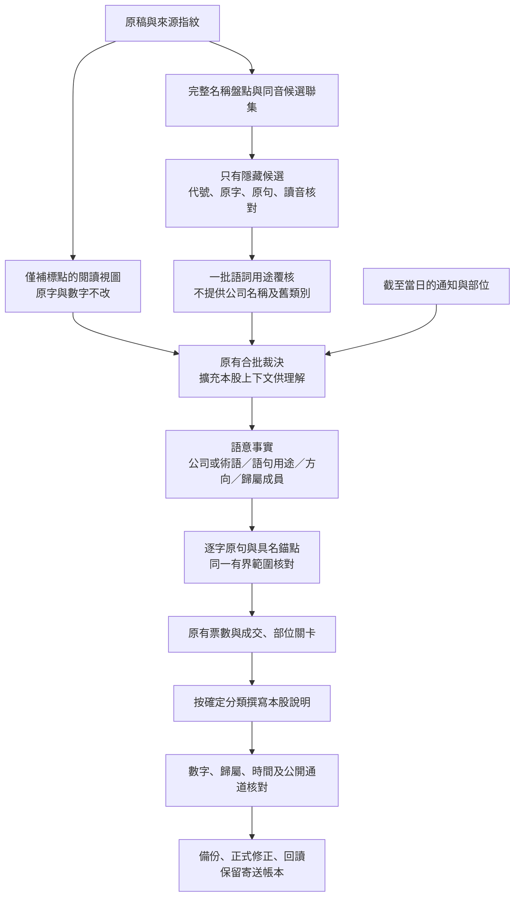

# 10/21 候選涵蓋、語意核對與發布政策

## 正式內容與實驗分開

本次重新查取正式保存的原稿，18,451 字，SHA-256 為 `6a65d0403d55fc6cc777f78deeede3825ca149478298e810a488d5879fe2b4cd`。來源審核 run：39573426698。不是以網站分類當答案。

依管理者 10/21 最新要求，已核對未出場部位、當日有本股分析的注意列，發布應列會員持股。美律既有部位起於 6/17，瑞鼎起於 9/30；不能用今天錯列衍生的回合證明今天分類正確。美律已經後台儲存並完成四階段同步；公開 API 逐列比較只有美律由注意移至持股，其餘列及文字未變。

正式日資料：買入 1、賣出 0、會員持股 7、觀望注意 5、觀望不碰 5；18 列、17 檔。全站未出場持有 15 檔，與當日提及持股 7 檔是不同母體。更新沒有重寄通知。後台顯示郵件查詢、持股追蹤與績效全部更新成功；首頁實際回讀為注意 5、未出場持有 15。

## 獨立判斷與邊界

`independent-v4-position-policy.json` 延續先前完整原稿判斷，按新政策修訂已確認部位兩檔，並加入已看到的「被動元件不是東元」開發反例。它是代理來源審核草稿，非人工金標、非新的盲測。25 項有決定，旭隼、匿名摺疊手機標的兩項仍未定；未定不當成應排除。

| 軸 | 判斷標準 | 不可推導 |
|---|---|---|
| 公司身分 | 名稱、原稿寫法、代號及上下文共同支持 | 代號存在不代表原詞是該公司；股價不能證明身分 |
| 今日交易 | 本人／會員今天已完成，或核實的當日執行指令 | 不要賣、過去賣、建議可以買，不是今日已成交 |
| 部位 | 截至當時可靠未全出紀錄或本股明講仍持有 | 觀眾部位、法人庫存、看多、當日錯列不能建立講者部位 |
| 現在立場 | 本股買點、前瞻、等待條件或當下風險 | 過去出場不等於今天沒有觀點；不要殺低不等於禁買 |
| 文字支持 | 本股原字、數字、日期、主詞、因果各有出處 | 原句存在不代表屬於本股；共用結論不共享各自成本與股本 |

持股與注意的發布政策：有已確認部位且本日有本股分析，列持股；未持有／未知則正面觀點列注意。剩餘持股與已賣部分暫不買回可以分軸並存。這不創造今天的交易。早期「持股／注意同組可接受」只按舊版本報告，不據此放寬新版精確發布。

## 為何會漏收、誤收與幻覺

1. **名稱之前就漏掉**：兩字簡稱被標 weak，舊補漏直接跳過；不在固定別名表的聽寫字，既有盤點也可能看不到。
2. **段落切法丟失語意**：原稿每字有空白但幾乎沒有標點；名單前共同結論被移到不可引用背景，股票後半句可能被下一檔範圍切掉。把整篇當同一句，又會把別檔指令借進來。
3. **收到答案後再次改意義**：模型的正面語意仍須命中特定前瞻詞，未命中便改中性；讓步句、責備殺低、先講結論後報名單容易失真。
4. **投票不等於獨立真值**：三輪同模型、同段落與同提示詞會共同誤判。「大量」被三票當成公司也仍然錯；晚補候選三票門檻則可能把兩個有根據的方向票留成不公開。
5. **說明與分類是不同缺陷**：分類正確仍可能借到別檔成本或股本。反覆整日 apply 會重寫全部說明，不能靠重跑收斂。
6. **測試入口本身可能失效**：本次新增模組首次從 scripts 入口載入失敗，被原有 catch 吞成維持初稿。已修檔案相對載入，並新增錯誤狀態，重播及品質關卡不能把未執行裁決寫成綠燈。該失敗不隱藏，也不當成新判法的模型品質測量。

## 候選版的設計（尚須真實回歸驗證）

- 閱讀視圖只補來源可對齊的標點，禁止在數字中間插入分隔符；原稿 SHA 不變。引用位置映回原稿，不拿補標點視圖位置冒充原稿位置。
- 完整名稱盤點只增加隱藏候選，或補回已有隱藏候選的原字定位；不新增交易、持股或價位。候選代號須在名錄，原字及短引句須在原稿；同音配對也不建立永久別名。
- 語意回覆明列 `entity`、`role`、`direction`、`scope`、`members`、`anchor`、`quote`。角色區分當下觀點、當下風險例、只講歷史、一般教學例、中性行情；不是只看有沒有「買／跌／以後」字樣。
- 語意引句和包含本股原字的錨點必須在同一有界來源窗，距離有上限；顯式成員不得與本股衝突，但原句已點名本股時，不因冗餘 members 空陣列而拒收。正式名與核對過的原稿寫法可綁定同一身分。窗口有別檔，不能把窗口全算成本股。缺欄／無法綁定是不採用該票，不是反對票，也不能偷偷回到詞表給一票。
- 當日成交與部位仍各有核對；新語意欄本身不創建交易、成本或持股。已全出只證明部位，不能自動推導今天只是在回顧。
- 不採用「從行情挑最像的數值把 13 改成 130」，也不採用整組名單強制同類或刪字串造成「並部位」的說明修法。
- 名稱候選先機械盤點，再一個用途批次；語意欄併入既有裁決，候選版最多五輪，只續問未定者，依封包大小可能拆批。五輪不是五個獨立裁判，更不能取代來源核對。評估流程串行，專案實際重試及換鑰仍須算入滾動 60 秒 15 RPM。
- `entry_restricted_now` 是現在買點未到；`sell_discouraged` 是勸不要賣，兩者分開問。「沒有買過」不是禁買。「有獲利」不證明講者持有。
- `492fcda` 新增每批預期與實收 ID、缺漏、未知 ID、回應鍵與原始回應存檔，區分模型沒有回覆與程式不採用回覆。最新輪五批完整，但仍有語意錯判。

## 測試紀錄

| run | commit／候選 | 結果及限制 |
|---|---|---|
| 39574320847 | ce33e8a，候選涵蓋與補標點 | 通用檢查過，獨立草稿 17/25；6 檔漏收，創意與大量誤收；不合併 |
| 39575734218 | aebf28a，首次語意批次 | 模組載入失敗，沒有真正進行裁決；不能以 13/25 衡量新判法，不合併 |
| 39576602233 | 448fd67 | 尚在排隊時取消，改測最後修正版；未呼叫模型 |
| 39576924834 | 13a448c | 19/25，16 次呼叫；六檔漏收，不合併 |
| 39577994618 | b2a2df4 | 19/25，17 次呼叫；冗餘成員欄缺答與來源身分缺漏，不合併 |
| 39588064651 | 714f787 | 21/25，22 次呼叫；大量誤收，群聯／富喬／台玻未確認，不合併 |
| 39589689329 | c463000 | 18/25，18 次呼叫；用途覆核錯排嘉澤、美律，鴻海誤作持股，多輪缺回覆，不合併 |
| 39590670175 | 492fcda | 20/25，18 次呼叫；五批收件完整，但神準誤排、鴻海／宜鼎誤持股、群聯分歧、富喬引句失效，不合併 |
| 39589723662 | 93d5303，另一分支 | 19/24，16 次呼叫；舊 v3 中瑞鼎、美律分類差異按新政策可接受，富喬／台玻漏收及創意誤收仍未解；不視為整合版結果 |
| 39591202469 | main 6fc1f4f，10/15 | 通過既有答案與通用關卡，14 次呼叫；分類不注入、停用人工／模型裁決快取、唯讀。不是廣泛語意候選的回歸證明 |

離線：候選／來源契約 31 項、正式安全邊界 3 項、來源修復 12 項、參考比較 10 項、工作流契約 2 項、來源評分 3 項、重建前置 1 項，合計 62 項重新通過。這些不是完整專案測試套件，也不等同模型分類品質。另一工作階段後續仍在修改共同檔案，不將本測試數字標為未提交整合碼已通過。

本文件七個 Codex 10/21 已完成實驗合計 125 次呼叫（16+18+16+17+22+18+18），加 10/15 歷史核對 14 次，合計 139 次；他方 run 用量另列，不重複算成 Codex 支出。首次語意測試程式故障的 18 次仍計入，不刪失敗只報成功。此數字不是專案當日總量。

## 已發布與尚未發布

`main=6fc1f4f` 只發布範圍已驗證的安全修復：未確認買賣列移至非公開 uncertain，裁決執行失敗留下品質錯誤；以及已確認部位的發布政策文件。候選廣泛語意改版留在 `codex/1021-acceptance-contracts`，未通過，不合併。這些是 Python 與文件變更，沒有 GAS 來源修改，不需要新建 Apps Script 版本。

2026/10/21 19:16 再讀正式首頁：買入 1、賣出 0、注意 5、不碰 5、未出場持有 15；世芯說明為等待自身量能與可用資金條件，不是等待低量。網站是正式發布證據，不作評估答案。

10/15 的通過僅表示既有答案列與通用關卡通過。日誌另列答案未涵蓋的所羅門（2359）；本輪沒有另行完整核定該額外列，不能據此宣稱當天所有候選都已獨立驗對或零誤收。沒有重套用 10/15 正式資料。

待處理的整合缺口與同檔修改邊界見 [合作驗收交接](合作驗收交接.md)。不能承諾未來零錯，也不能因已核對的正式資料正確就把模型實驗報成通過。
