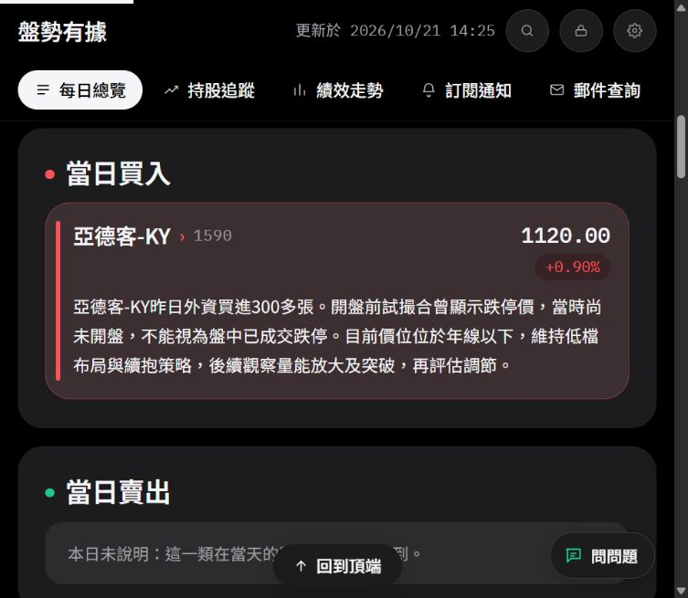
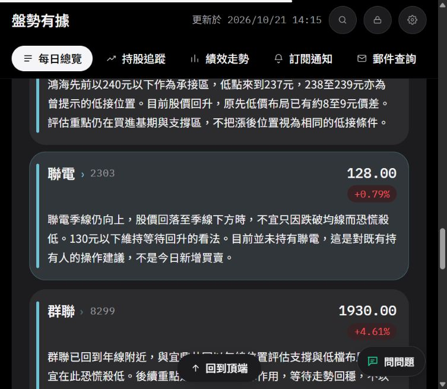

# 2026/10/21 來源修復與分類差異驗收

## 結果與證據界線

已完成今日來源綁定修復及正式 API／首頁讀回。今日共18個分類列、17檔股票：買入1、賣出0、當日提及持股6、注意6、不碰5。亞德客的買入與持有是兩個不同事實，並非兩檔。全站追蹤中的15檔是歷史未出場部位，不能拿來與當日持股6筆互比。

本次來源修復不呼叫模型、不寄送。三張表先備份至獨立備份檔；寫入後逐欄比對，其他日期與受保護來源未變，郵件查詢、持股追蹤、績效三項刷新完成，已寄送旗標及Email／LINE帳本未變。

網站更新證明已修好的內容，不證明通用模型已穩定。兩次未注入答案的重播均有差異，候選分類修法未合併。獨立判斷是代理原稿審核草稿，不是人類核定金標；多個AI同意也不能把它升格為人類答案。

## 來源與先後順序

- 影片：`6iuyHqHwnjI`，當日選中原稿18,451字。
- SHA-256：`6a65d0403d55fc6cc777f78deeede3825ca149478298e810a488d5879fe2b4cd`。
- 完整原稿取回：[來源稽核39551806447](https://github.com/Lee200202/Stock/actions/runs/39551806447)，零模型、零寫入。
- 先讀閱讀稿，再完整讀保存的未改寫原稿；獨立v1在查看目標流程輸出之前保存。曾看過流程名稱與git修改主題，不能稱完全盲測。v2補上原稿已有的亞德客及已讀回的當日通知；v3更正嘉澤、群聯兩處縮寫引句，不改分類，明載已看過重播。
- 後台實際讀取原通知186353358，確認當日有亞德客的新會員買進指令與既有部位續抱。此為產品中的操作指令紀錄，不是券商成交證明；不公開通知隱藏價位。
- 先前自動稿與後台手動保留稿是不同版本，閱讀稿也屬加工輸出。未擅自切換管理者設定的原稿優先順序，未把兩份數字無標記混成新原稿。

## 為何10/21無法套用

1. [apply-rules 39546165811](https://github.com/Lee200202/Stock/actions/runs/39546165811)與apply 39546015578，都是缺少` scripts/golden/2026-10-21.json`，在模型與寫入之前停止。不是部署權限錯誤，也不是這次模型品質關卡不通過。現在錯誤訊息會列出缺少路徑、停止階段及來源修正預覽入口；不取消答案保護。
2. 第一個來源修正預覽39552505549停在力積電，實際日誌中的現有說明SHA與計畫SHA相同；不符的是`MANUAL-20261021`與影片ID。修正工具以同一錯誤涵蓋來源／指紋兩項，不能據此說是說明再次被重寫。逐筆確認手動來源後才在計畫註明覆核，不放寬通知保護。
3. 真實分類還有漏收及跨股挪用，與缺少答案檔是不同問題。通用檢查綠燈不足以證明這些已修好。

## 本日來源判斷與流程最早分歧

| 個股／情境 | 來源判斷 | 實測差異及缺口 |
|---|---|---|
| 鴻海 | 昔日出場；今天重申240以下承接區並評估回升，列注意，不是今日買進 | v21候選直接用歷史已出場判回顧；v20另一次能收回，表示尚有隨機與路由差異，非全面缺乏原句 |
| 聯電 | 明講自己沒有，但季線向上、130以下不要殺低並預期漲回，列注意 | 初判未列，後補成注意；無效引句及反向票造成三票門檻不過。否認部位與當下觀點兩軸混淆，不能只減少門檻 |
| 群聯 | 與宜鼎共用前置年線與不要殺低的現況結論，列注意 | 一輪完全沒有裁決痕跡；另一輪曾建候選但判只有點名。須分別查候選漏項及前置共用結論，而非統稱票太嚴 |
| 宜鼎 | 同一年線條件；較弱後接小股本、拉升較快，列注意 | 一輪引句失效被排除；另一輪三票不碰。引用內容甚至保留正面後半，仍被當成還不能買，需查模型語意及禁買證據，不是三票就可靠 |
| 瑞鼎 | 融資減、法人承接及60分MACD未背離，具向前觀點；既有持股不新建 | 兩輪沒有本股裁決痕跡。原稿瑞頂與相鄰代號／破碎名稱須共同核對；不能從價格反猜公司 |
| 美律 | 本股季線突破回測與法人承接，具正面觀點；部位另核 | 紀錄上持有可列持股，屬使用者允許的持股／注意標籤差異，不能和實際漏收混算。文字只寫有買有賣，漏掉自己的技術依據 |
| 世芯 | 尚未買回，等待明確量能及可用資金，列不碰 | 正式舊文多出低點量縮；v21候選把宜鼎小股本、上漲較快搬入世芯。原句存在不代表屬於本股 |
| 台積電 | 已站回季線；2,490高於當時2,425，是尚未回補的上方缺口 | 舊列寫下方缺口，數字單獨存在但方向錯。不能僅核對數字集合 |
| 嘉澤 | 往日賣一半，現在剩餘持股未賣 | 不能改成今天賣，也不能擅自寫主要部位已留下而改變比例 |
| 台郡、富喬、台玻 | 名單同指今日轉弱及追強風險，可列不碰例子，不是今日賣出 | 流程只保留其中一檔或全排除；共同風險須逐檔取證。不擴大成所有教學例子都必須公開 |
| 匿名／序字段落 | 選中原稿無法獨立確定旭隼身分，保留待核 | 不以另一份閱讀稿、原有持股名單或AI多數直接補入當日分類；既有歷史持股回合保持 |

同日稿4檔／另一稿16檔的正式名稱命中量是診斷提示，不能直接當ASR正確率。近音字、字間空白、斷句與公司代碼配對都會影響命中；自動稿並不因此在每個句子都更可靠。另一工作階段新增的原稿品質提示已在main，這輪保留。

## 正式修復紀錄

| 執行 | 結果 |
|---|---|
| 39552505549 | 預覽失敗，來源ID未逐筆授權，未寫入 |
| [39552901545](https://github.com/Lee200202/Stock/actions/runs/39552901545) | 15筆預覽通過；原稿、官方身分與舊列來源／SHA均核對 |
| [39553021690](https://github.com/Lee200202/Stock/actions/runs/39553021690) | 正式9筆更新、6筆新增；備份、逐欄讀回及三項刷新成功；模型0、寄送0 |
| 39553683114 | 世芯資金條件文字預覽通過 |
| [39553815741](https://github.com/Lee200202/Stock/actions/runs/39553815741) | 再局部澄清世芯資金條件，避免「原有部位」被誤讀為世芯仍持有；備份、讀回、刷新及帳本核對成功 |

第一版計畫保存在`applied-source-plan-v1.json`；現行單日計畫只保留世芯文字澄清，歷史修改在git與修正收據。不得把已套用的舊計畫當成可對任何新稿重用的答案。

最後逐日編輯讀回時另發現，受保護亞德客通知列的公開背景說明把開盤前試撮合寫成「盤中開盤試搓合」。已對照原稿「8點45…到九點還沒開盤」「又沒有開盤」與本股年線／外資段落，僅在後台更新買入及持有兩則書面說明。原通知、方向、價位、來源與部位不動；逐列API前後比較顯示只有1590買入的`reason`及持有的`note`變化，所有分類的代號集合與其他列欄位相同。這兩則修改走既有逐日編輯記錄及背景同步，不修改來源修復工具對通知交易的保護。

逐日編輯接續執行39555014011、39555117426；後台最後顯示100%完成、郵件查詢／持股／績效全部更新成功。公開郵件查詢亦讀回「開盤前試撮合」，不再含「盤中開盤試搓合」。前台14:25版本實際可見新說明：

正式API的日期查詢與郵件查詢均已確認：含上方2,490、群聯、宜鼎及世芯可用資金條件，不含舊文「低點量縮」。首頁實際點選查看六檔注意卡片，後台逐日編輯也讀回18列與新說明。

後台前次手動投稿工單仍顯示13:02的「待複核11項」，那是原次模型診斷歷程，不因這次來源修復自動清除。不得把工單歷史改成全過，也不得用今日狀態綠色隱藏尚未通過的分類實驗。

本輪正式程式改動只有Python單日套用的錯誤訊息，另有文件、技能參考及修復計畫；未修改GAS／Worker／前端程式，無需為本輪另切Apps Script部署。缺答案預檢1項、來源修復12項、工作流模式契約2項離線測試通過；技能UTF-8格式驗證通過。歷史覆核候選4項測試另列，不當正式分類品質分數。

## 未輔助模型實驗：未通過，不合併

| 執行 | 條件 | 結果 |
|---|---|---|
| [39552967276](https://github.com/Lee200202/Stock/actions/runs/39552967276) | v20，停用人工／模型裁決快取，獨立v2只在推論後比對 | 17/24分類相符，6項漏收及1項持股／注意差異；通用檢查通過，但分類草稿差異退出4；14次記錄呼叫 |
| [39553585347](https://github.com/Lee200202/Stock/actions/runs/39553585347) | `36de04d`候選，讓「已賣出所以只是回顧」納入同批直接覆核 | 16/24分類相符，8項差異；仍漏聯電、瑞鼎、群聯等，宜鼎誤列不碰；19次記錄呼叫；不合併 |

候選四項離線測試確認：歷史回顧進入同批覆核、純回顧不自動升格、通知與核實部位不重問、多檔只發一次；它們不是模型準確率證據。本次真實候選也沒有充分命中原先想驗證的歷史直接分支，因此不能宣稱該分支已由真實案例證實改善。

兩輪相同原稿SHA及已記錄部位上下文SHA，均未注入分類答案；仍讀目標日通知、名稱紀錄與既有上下文，並非完全隔離。期間正式說明更新，輸入未完全凍結；不是嚴格單變數A/B，更不能用一次17→16判定統計顯著退步。用途是拒絕不符合本日成功條件的候選。

本輪新發動的模型重播共33次日誌記錄呼叫，串行；設定上限15RPM，日誌平均約7.0與6.6次/分。平均值不是整個模型專案的滾動分鐘保證，其他工作及底層重試仍需合計。來源預覽、套用與離線測試不消耗模型。未以重複套用嘗試抽到一個合格版本。

## 採用與保留

- 正式採用：來源綁定的今日資料修復、缺少答案檔的明確錯誤訊息、分類邊界規格及技能的候選／已發布狀態區分。
- 保留他人main中的只讀原稿品質提示；保留共享工作區未提交內容，不覆寫。
- 不合併：本輪歷史覆核候選及`claude/1021-verdict-v21`未通過的分類改動；不新增未核定全域別名、不把今天金額或句子塞入正式Prompt。
- 不做：由兩個AI互相同意直接產生「人工核定」10/21答案檔；按名稱命中量自動改原稿優先順序；匿名身分強行補入；重新寄送通知。
- 尚未證明：未來新稿零幻覺、完整分類召回率穩定、模型跨日無退步。本次沒有新增歷史正式寫入；其他日期的實驗與修正需另以當日原稿及當時部位驗收。

## 下一步通用流程的驗收條件

依來源候選聯集逐檔保留已判／待核／未答狀態，不讓弱名稱默默消失；交易、部位與當下觀點分軸。相鄰共用條件連同名單一起交同批AI，個別數字與題材獨立歸屬。文字生成後再批次核對主體、時間、動作、數字關係及條件確定性，不能只查引用是否存在。最後才做分類定案、發布及同來源後續補漏。

採用候選前至少解決本日已重現的遺漏／反向問題，再使用較早未用於該候選調整的日期核對新誤收、交易／部位副作用及說明歸屬。若仍未過，保持來源修復及既有正式流程，明載未解缺口，不用綠燈或單次多數票代替驗收。
