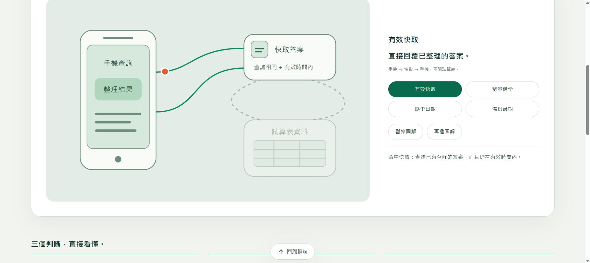
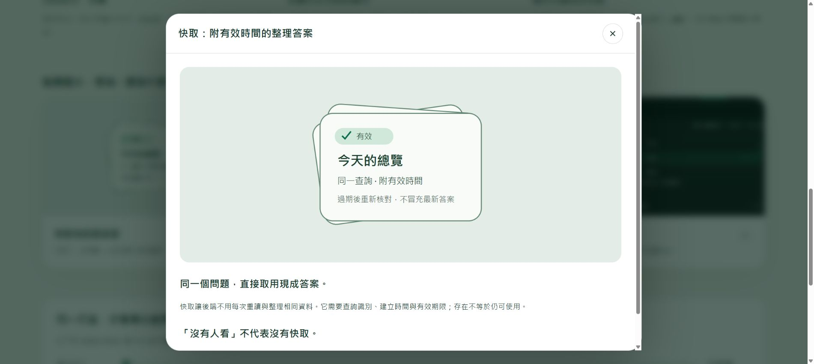

# 技術說明圖像章節式改版：交付入口

這輪完成 **Apple 官網研究、正式頁診斷、完整執行 Prompt、20 章分配表與三頁互動原型**。尚未修改或部署正式網站。

### 2026/10/16 第二份心得已融合

已完整讀取管理者提供的878行體驗規格與附件摘要，融合至同一份 [執行Prompt.md](執行Prompt.md)，桌面 `tech_doc_ui_ux_redesign_prompt.md` 與它同步，原心得另留桌面備份。

新增五站全景、六類資料群、八類鍵值卡、局部UI、19筆用量看板、章節進度、列印及搜尋規格。也更正速度倍數、錯誤股名、缺值取價與「保守估算」等矛盾；完整25項採用／調整清單見 [整合取捨與查證.md](整合取捨與查證.md)。

這次是**規格融合**，下列原型仍是原有三頁；新增模組尚未實作，先前30組原型檢查不能代替它們的驗收。

## 交給實作 AI

先交付 [執行Prompt.md](執行Prompt.md)，並附整個資料夾。它明確列出：

- 20 章的主圖、案例、互動及必要資訊安排。
- 舊章節到新章節的內容保留與錨點相容要求。
- 圖片卡開啟說明視窗、章末橢圓上一章／下一章。
- 分支動畫、播放控制、路由、CSS 與 HTML 程式範例。
- 手機、大字、寬版、鍵盤、減少動態、無 JavaScript 的驗收標準。
- Pages 與原 Apps Script 部署的一致性、回退及證據要求。

## 研究與對照

[研究與現況診斷.md](研究與現況診斷.md) 包含 **22 個 Apple 官網內部頁面**的逐頁參考與本站轉譯；另列輔助網站及查驗限制。實際操作的代表互動是 iPhone 圖卡開啟／關閉大型圖片說明視窗，不宣稱 22 頁的所有互動都已實測。

[chapter-map.json](chapter-map.json) 是 18 舊章到 20 新章的分配草案。正式施工還需建立逐項內容 inventory，才能證明全部內容且僅一次搬移。

## 原型怎麼看

在本資料夾啟動靜態伺服器：

```powershell
python -m http.server 8798 --bind 127.0.0.1
```

然後開啟 <http://127.0.0.1:8798/prototype.html>。也可從檔案開啟 `prototype.html`；本原型不依賴 fetch 或外部框架。

原型實作：

- 快取的手機／中介答案／試算表空間圖，四種可選情境。
- 進入圖解自動播放、循環、選情境暫停、再播恢復。
- 圖片卡開啟原生 dialog；Esc 關閉、焦點返回。
- 代理工作桌主圖、20 章提案目錄。
- 三頁的章末上一章／下一章、瀏覽器返回、深淺色、手機構圖。

這不是已完成全部內容的 20 章網站，也沒有實際 API、模型呼叫、正式資料更動或通知。

## 本輪實際驗收

日期：2026/10/16。本機瀏覽器原型，與正式網站部署驗收分開。

| 項目 | 結果與範圍 |
|---|---|
| 五種寬度 × 兩主題 × 三原型頁 | 360、390、768、1440、1916px，共 30 組；無整頁水平溢出、僅一章可見、無缺圖；所查導覽／舞台控制高度至少 44px |
| 四種情境 | 命中／備份只有 request、return；歷史無快取／備份過期加入 source、store；選後均暫停 |
| 再播與循環 | 再播後實際觀察連續 5 輪仍播放；手動暫停後狀態停止 |
| 切章與歷史 | 章末下一章切至代理頁，瀏覽器返回回到快取頁；離開快取頁時播放停止 |
| 圖卡視窗 | 快取圖卡可開啟，開啟時後方停止；Esc 關閉，焦點回原圖卡 |
| 手機主圖 | 另排節點、替換路徑與大標籤，非只縮小桌面圖；390px 截圖人工檢視 |
| 底部中央回頂 | 原型保留中央位置；與可操作內容相交時暫隱，避免壓住情境控制 |
| 套件靜態檢查 | 20 唯一章ID、18舊toc相容映射、22個Apple連結、40個HTML ID無重複、資產／內連結存在；JS語法通過 |
| 減少動態／隱藏分頁／無JS | 程式與CSS靜態查核；本輪未切OS減少動態設定、未做真正停用JS的瀏覽器驗收，正式施工仍必測 |
| 正式部署 | 本輪未進行；正式頁只作診斷與截圖來源 |

30 組讀回結果見 [prototype-layout-results.json](prototype-layout-results.json)。檢查程式：

```powershell
python check_package.py
node --check prototype.js
```

這些檢查驗證交付包與局部原型，**不代表正式站 20 章已通過，也不代表正式內容已完成遷移**。

## 實際原型截圖

### 寬版主圖



### 點圖後的大圖說明視窗



### 手機重新構圖


圖像均自繪；改版前截圖取自本站。Apple 圖片只在研究時查看，沒有複製到原型素材。
