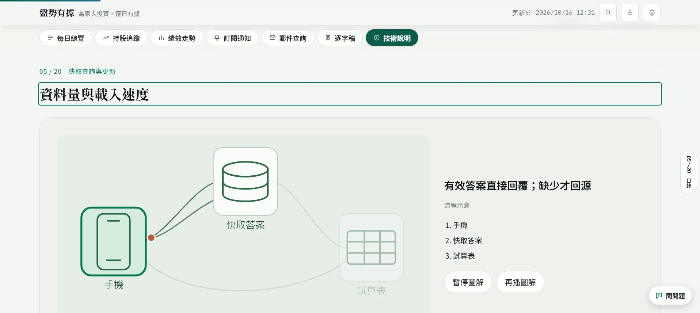
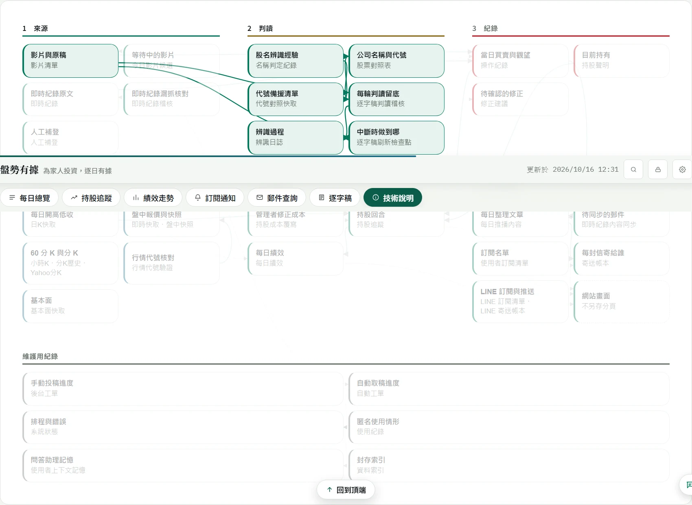
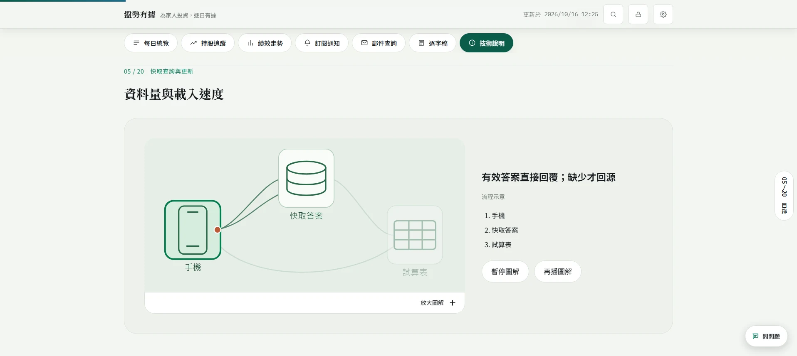
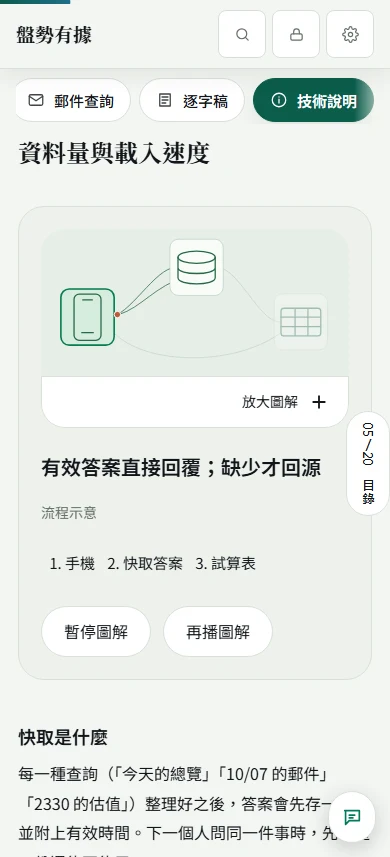
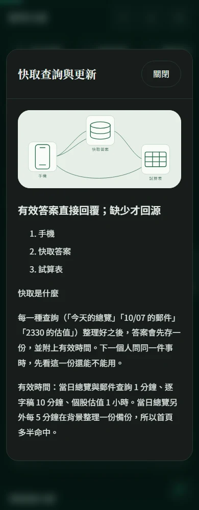

# 技術說明重設計：實作與正式站驗收

日期：2026/10/16。正式 Pages 已上線並完成本輪實測；Apps Script HEAD 已同步並建立485版，原 `/exec` 仍需擁有者切換，兩面尚不能宣稱全數完成。

## 一、已實作

- 技術頁從18個舊章重組為20章，每次顯示一章；原有文字、案例與來源項目以穩定ID逐項搬移。
- 595個原段落、清單、案例按鈕與來源項目都仍存在，且每個content-id恰好一次；7項文字調整有紀錄（四個快取按鈕縮名、資料關聯取價更正、歷史案例口徑標註及其所屬容器文字變化）。
- 原有六階段工作關聯、34個資料節點、點選上游／下游與圖內捲動保留。9/23時間線按鈕可以跨章回到對應資料節點。
- 新增20張自繪向量主圖、圖片說明視窗、章節搜尋、右側目錄與章末橢圓形前後章。
- 五站全景直接可讀；原details內容改為直接呈現的卡片；原稿稽核、公開說明、匿名個股、分類與投票案例保留。
- 單一播放控制器依作用中章節、視野、分頁可見性、使用者停止、說明視窗與減少動態控制播放。選案例停止，再播後循環。
- 五站圖與持股回合在較下方進入視野仍會播放；舊播放按鈕的文字與真實狀態同步。作者與聲明維持靜態。
- 快取有效時只往返手機與快取，未命中才進來源分支；情境只有一組控制。
- 無JavaScript時20章確實可見；列印技術頁可輸出全部章節，不強迫其他分頁列印技術內容。
- 正式頁不加入Apple研究、交付、原型或提示詞等施工用語。保留必要的示意、歷史日期與限制。

## 二、程式與內容清單

| 檔案 | 職責 |
|---|---|
| `public-site/gas-source/Tech.html` | 完整靜態章節、原有案例與資料控制 |
| `public-site/gas-source/StoryDesign.html` | 新閱讀外殼、目錄、路由、視窗、播放與響應式樣式；取代舊包裝 |
| `public-site/gas-source/JavaScript.html` | 技術書頁使用自身目錄，避免舊目錄重複控制 |
| `public-site/assets/tech-book/*.svg` | 20張向量圖；Pages與原GAS使用相同資產 |
| `Config.gs`／`Setup.gs`／`Changelog.html` | build、檔案標記與變更紀錄 |
| `scripts/check_tech_book.py` | 可重現的分章閱讀驗收 |
| `tech-content-inventory.json` | 595項內容的原文、原位置、新位置及更動標記 |

本輪沒有更改分類演算法、行情取價、正式資料、通知帳本或排程，也沒有寄出Email／LINE。其他工作階段的內容修改與未提交檔案保留。

## 三、實際驗收

| 範圍 | 結果 |
|---|---|
| 本機全章版面 | 1916、1440、768、390、360px × 深淺色 × 20章，共200組；無整頁水平溢出 |
| 寬版大字 | 1916px、`data-w=w`、`data-fs=l/x`，每種20章；無整頁水平溢出 |
| 後續修正回歸 | 1440、390px × 深淺色 × 20章，80組及功能檢查通過 |
| 正式Pages最後版 | 80組版面、寬版大字、案例、圖卡、搜尋、重播、列印、減少動態及無JS檢查通過；資料見 `acceptance-v184/live-results.json` |
| 原稿稽核 | 8種情境的原稿指紋、階段與結果可觀察且互不相同 |
| 公開說明 | 7種案例結果可切換 |
| 匿名個股 | 唯一、同價多檔、無符合三種結果可切換 |
| 六階段關聯 | 6種工作說明不同、34節點可保留互動；時間線按鈕可跨章開啟節點 |
| 快取分支 | 有效快取與備份不走試算表；另外兩種情境走來源分支 |
| 圖卡視窗 | 原生dialog開啟、圖片載入、Esc關閉、焦點回原卡 |
| 自動播放 | 再播後連續兩輪仍播放；手動停止與減少動態確實停播 |
| 舊回合播放器 | 正式站觀察日期前進、暫停／恢復；作者沒有播放控制與自播 |
| 相容與歷史 | 正式站18個舊toc錨點逐一核對；刷新、瀏覽器上一頁／下一頁通過 |
| 無JavaScript | 另開真正停用JS的瀏覽器context，20章全部可見 |
| 列印 | 技術頁列印模式可見20章 |
| 原站橋接 | `check_original_parity.py`：30個公開／60個後台方法對齊 |
| 行情回歸 | `check_quote_flow.js` 12種情境通過 |
| 正式API | `check_site_api.py` 通過，最新日期2026/10/16 |

測試腳本只做教學互動與唯讀查詢；沒有啟動取稿、重新分類、正式資料寫入或通知。截圖與API成功不能取代未完成的原Web App視覺驗收。

## 四、發布狀態

| 部署面 | 本輪狀態 |
|---|---|
| GitHub程式 | `17ce07e`主要重設計；`c99c50c`播放／跳轉；`dac936e`無JS；`6bf0572`列印範圍與觸控 |
| Pages | `6bf0572`建置成功：[38850715678](https://github.com/Lee200202/Stock/actions/runs/38850715678)；其後`bf25cd1`亦建置成功：[38850994837](https://github.com/Lee200202/Stock/actions/runs/38850994837)，正式頁已測 |
| GAS HEAD | 已推送42檔；最後同步七個Git已提交檔案，包含保留另一工作階段`bf25cd1`的公開文案過濾修正（JavaScript及Presentationquality），保留雲端額外Editor／Review與其他後端檔案。七檔內容與`bf25cd1`按換行正規化後相同 |
| 不可變版本 | **485**，build `2026-10-16-tech-book-v184r1`；483、484為中間版，請選485 |
| 原 `/exec` | 部署清單仍指向482；ping讀回 `2026-10-15-class-cards-v183`。原URL沒有另建或替換 |
| 權限限制 | CLI更新原部署回覆 `Only users in the same domain as the script owner may deploy this script.`；沒有改權限或另建部署迴避 |
| 原 `/exec` 新版視覺 | 尚未驗，必須先由擁有者切到485版 |
| Worker／LINE relay | 本輪未修改或部署 |

### 擁有者剩餘一步

原Apps Script專案 →「部署作業」→「管理部署作業」→ 編輯原Web App → 版本選 **485** → 部署。保留原執行身分、存取權與URL。

切換後需讀回ping為`2026-10-16-tech-book-v184r1`，並在原`/exec`實際操作目錄、快取分支、圖片視窗、六階段關聯及手機版。這一步未完成前，不宣稱Pages與Web App已全部對齊。

## 五、正式Pages截圖

下列是正式Pages讀回，不是三頁設計原型。

## 六、回退

程式回退至本輪之前的`cec5911`或逐筆revert本輪四個程式提交；原Web App維持或回到部署482。回退不需要變更任何正式資料或寄送帳本。`tech-content-inventory.json`可用於重新核對內容，不可把三頁設計原型當成完整舊版替換。
