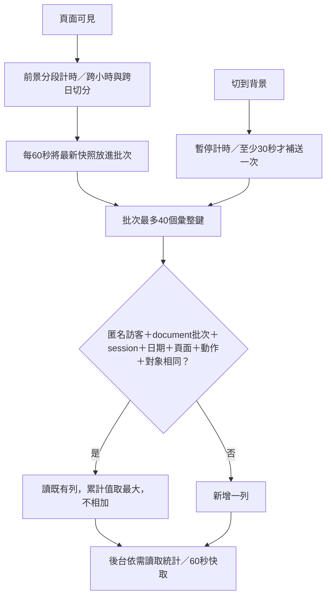

# 匿名使用分析：研究、資料定義與工程設計

日期：2026/10/18。範圍：盤勢有據前台、後台、使用紀錄工作表及原 Apps Script 部署。沒有安裝第三方追蹤 SDK、錄製畫面或串接訂閱信箱。以下是產品分析設計；不同服務的 session、活躍與停留時間定義不盡相同，不能直接混算。

## 一、為何原本一直新增列？

原本前後台在 visibilitychange 變成背景時，用「現在－最初進站時間」回報停留。起點沒有隨暫停更新，後端每次又 append，造成同一頁 4201、4203、4205 秒各一列。這些是重複累計快照，不能相加；期間是否真的在前景也無從回推。

新版：

真正離開頁面時 Pages 使用 sendBeacon 做最後一次盡力補送，原 Web App 仍走原 bridge。排進瀏覽器送出佇列不等於後端收到；每分鐘 checkpoint 降低最後一筆遺失的影響。失敗保留最新快照，後續批次重試，不高頻重試。鎖忙時最多等1秒，回報 busy；不與主流程長時間搶鎖。

**同一筆的精確範圍**：同一 document、同一 session、同一台灣日期、同一頁面的停留是一筆；切到別頁再回來更新原列並增加瀏覽次數。重新開啟另一個分頁是不同 document；超過30分鐘沒有活動後重返另起 session。跨台灣午夜另列，讓日期篩選正確。互動則依動作及對象另行彙整次數。

## 二、官方資料研究：22個不同網站／供應者

逐一搜尋官方文件，Google Analytics 與 YouTube 同屬 Google，合併算一個來源網站，沒有把兩個頁面灌成兩站。以下22列各為不同網站或供應者。研究提供設計依據，不代表本站與任一供應者的定義完全相同。

| # | 官方來源 | 得到的做法 | 本站採用／取捨 |
|---|---|---|---|
|1|[GA4工作階段](https://support.google.com/analytics/answer/12798876)、[投入瀏覽](https://support.google.com/analytics/answer/12195621?hl=en)、[YouTube分析分頁](https://support.google.com/youtube/answer/9002587?hl=en)|分開訪客、session、投入互動；Studio用總覽／內容／觸及／觀眾|採30分鐘不活動另起session；以總覽、內容、來源、觀眾與收集效率分層，不引入與本站無關的營利指標。|
|2|[Plausible指標定義](https://plausible.io/docs/metrics-definitions)|瀏覽、訪次、時間、深度需要各有定義|採可見時間與深度；標明不是實際注視。|
|3|[Matomo heartbeat](https://matomo.org/faq/how-to/faq_21824/)|heartbeat可補最後一頁的時長，不必增加頁面瀏覽|每分鐘更新同一列，瀏覽數只在真的進入／切換時增加。|
|4|[Umami定義](https://v2.umami.is/docs/metric-definitions)|訪客、訪次與自訂事件不同|動作次數不拿來當訪客數。|
|5|[PostHog sessions](https://posthog.com/docs/data/sessions)|瀏覽器session、非活動時限與跨分頁|本地隨機session跨同源分頁共用；document另有識別避免快照碰撞。|
|6|[Amplitude留存時間](https://www.amplitude.com/docs/analytics/charts/retention-analysis/retention-analysis-time)|日曆日與滾動24小時有差異，留存觀察窗必須完整|統一台灣日曆日；資料不足不造D1/D7留存。先提供跨日回訪。|
|7|[Pendo stickiness](https://support.pendo.io/hc/en-us/articles/360031864252-Measure-stickiness)|活躍比例用於頻率而非主觀喜好|提供活躍天數、期間活躍日比例及常訪人數，不杜撰0–100忠誠分。|
|8|[Heap session例外](https://help.heap.io/hc/en-us/articles/37271976666001-How-does-Heap-work-with-WebViews)|Web與行動SDK定義可能不同|本站Web只採一種30分鐘定義，不混用平台預設。|
|9|[Fullstory active與elapsed](https://help.fullstory.com/hc/en-us/articles/360020622534-Can-Fullstory-provide-baseline-averages-by-segment)|前景或活躍時間與整段經過時間應分開|背景不計，休眠造成大跳時只保留最後60秒上限，不聲稱注意力追蹤。|
|10|[Microsoft Clarity dashboard](https://learn.microsoft.com/en-us/clarity/insights/dashboard-features)|從總覽與篩選找高低互動內容|採閱讀深度、常用操作、裝置與來源；不導入畫面錄影。|
|11|[Hotjar內容優化](https://help.hotjar.com/hc/es/articles/12662300637207-C%C3%B3mo-mejorar-tu-copia-con-Hotjar)|用閱讀／互動觀察改善文字|用章節與操作事件觀察，不記錄表單內容。|
|12|[Adobe time spent](https://experienceleague.adobe.com/en/docs/analytics/components/metrics/time-spent)|平均時間依分母而異|卡片寫明每位訪客閱讀＝總秒數／匿名訪客，不叫平均session時間。|
|13|[Cloudflare高階指標](https://developers.cloudflare.com/web-analytics/data-metrics/high-level-metrics/)|Visits、pageviews、載入時間不是同一件事|不把快取請求或後端讀取秒數當閱讀時間。|
|14|[Vercel自訂事件](https://vercel.com/docs/analytics/custom-events)|預先命名的事件與結構化屬性|事件名稱固定，對象限章節ID、股票代號或網域。|
|15|[Fathom dashboard](https://usefathom.com/docs/start/dashboard)|日期、來源、熱門內容組合分析|7／28／90天及等長前期，來源網域單獨圖表。|
|16|[GoatCounter事件](https://www.goatcounter.com/help/events)|可統計外部連結操作|僅儲存外連網域，不含URL查詢字串。|
|17|[OpenReplay dashboards](https://docs.openreplay.com/en/v1.23.0/product-analytics/dashboards/)|產品行為與流量總覽分層|內容、來源、觀眾各有圖表，減少一頁混雜。|
|18|[Simple Analytics Stats API](https://docs.simpleanalytics.com/api/stats)|median與average不可互稱|本站只做明確算式的平均，不把平均誤標中位數。|
|19|[Countly retention](https://support.countly.com/hc/en-us/articles/4414450842009-Retention)|回訪與分群留存各有觀察範圍|目前顯示期間至少2天回訪／至少3天常訪；不把它叫第7日留存。|
|20|[MDN sendBeacon](https://developer.mozilla.org/en-US/docs/Web/API/Navigator/sendBeacon)|離頁非同步送出，unload不可靠|visibilitychange先checkpoint，真正pagehide再盡力補送。|
|21|[W3C Beacon](https://www.w3.org/TR/beacon/)|低優先級傳送、可合併請求、不阻塞離頁|只送小型批次，不等待最後回覆，不宣稱100%送達。|
|22|[Segment customer data規劃](https://gopages.segment.com/rs/667-MPQ-382/images/segment-on-customer-data-ebook.pdf)|先以業務問題定義事件與屬性，避免無限制動態名稱|只收能回答內容品質、導覽、來源與回訪問題的欄位。|

## 三、實際後台架構

- **總覽**：匿名訪客、總閱讀、每位訪客閱讀、回訪比例；每日時間趨勢、熱門頁面、24小時熱度、投入瀏覽。
- **內容**：各頁閱讀時間、頁面瀏覽次數、平均最深閱讀位置、常用操作與技術章節。
- **來源**：進站來源網域、入口頁面、裝置、按出本站的外連網域。來源可能被瀏覽器政策隱去，直接／未知不能解讀成全是直接輸入網址。
- **觀眾**：匿名ID的閱讀時間、活躍日期、session及頁數；點選查看常讀頁面、期間活躍日比例與最深閱讀位置。最多顯示前50位，並不是完整訪客名單。
- **收集效率**：客戶端快照與停留列數、彙整比例、送出節奏、讀取列數、舊資料排除數、同期變化及資料起點。

圖表用本站原有色票、圓角卡片、膠囊控制、SVG及CSS transform動畫；進入視窗才播放一次，減少動態時直接顯示。數字直接顯示正式值，沒有從零遞增的假計數。功能只在打開分析分頁或手動更新時讀取；不新增定時輪詢或模型呼叫。

## 四、資料字典與公式

| 指標 | 算法／界線 |
|---|---|
|匿名訪客|選定期間內隨機瀏覽器ID去重。非登入身分，清除儲存或換裝置會重算；同一人可能多個ID。|
|session|同源瀏覽器共用session ID；30分鐘沒有活動後另起。不同document的前景時間可能重疊，因此不宣稱是單一真人專注分鐘。|
|可見閱讀|頁面前景分段秒數，每document／session／日／頁取最大快照值；背景不計。頁面開著但沒閱讀仍可能計入，已明確標示。|
|頁面瀏覽|進入頁面加1；停留checkpoint不加。切走再返回同頁加1。|
|每位訪客閱讀|總可見秒數／匿名訪客數。|
|閱讀深度|已展開頁面視窗底部／當時頁高，向下取25%級距，保留該頁最深值。圖表為頁面彙整列的平均；不等於讀完比例。|
|回訪比例|所選期間至少2個台灣日期有紀錄的匿名訪客／本期匿名訪客。|
|常訪|所選期間至少3個台灣日期有紀錄的匿名訪客。這是本站門檻，不是業界統一標準。|
|個人活躍日比例|個人有紀錄日期數／選定日數。|
|投入瀏覽|session可見≥10秒，或頁面瀏覽≥2，或有自訂互動；採GA4概念並明示本站事件邊界。|
|來源網站|每個session的首個來源網域，無完整URL及query；不取得其他網站瀏覽紀錄。|
|入口頁|session首個事件的入口頁屬性。|
|24小時熱度|計時在跨小時邊界分段，按台灣0–23時累計，不把整段塞到最後回報時刻。|
|同期變化|(本期－等長前期)／前期×100%。前期為0時無百分比基準；新制未覆蓋前期時顯示不足。|
|快照列彙整率|1－停留彙整列／客戶端生成快照次數。這個基準不是HTTP請求數、費用或Apps Script耗時。|

### 使用紀錄欄位

保留原A–G：時間、訪客識別、頁面、動作、對象、停留秒數、裝置。
H–R為內部資料：彙整識別、瀏覽批次、更新時間、來源網域、閱讀深度、快照次數、入口頁、瀏覽次數、互動次數、來源版本、時段秒數。初次新版寫入自動新增並隱藏H–R，不影響管理者原本七欄的閱讀。

彙整鍵持久存於H，不只依靠會過期的CacheService。快取列號失效時先核對H，必要時只查該欄；清理／排序後不會照舊列號覆寫別人。批次相同鍵先在記憶體合併，一批只append一次。重送與較舊快照只取各累計值最大值。

舊開著的網頁無session時，只對最近200列中推算起點相差30秒內的長停留做相容合併，不猜不同短訪次；這類資料仍標legacy，不放進新制平均與回訪。既有90天保留政策不在本次變更範圍，沒有為了漂亮數字刪除歷史。

## 五、資料量與成本控制

- 每分鐘一批、背景補送至少30秒間隔，最多40個鍵；失敗佇列亦有界，不無限累積。
- 後台分析最多讀最近30,000列，超出會醒目提示不是完整期間；最多50匿名訪客及前30種動作，圖表最多12項。
- 統計快取60秒；更新按鈕可強制重算。期間切換時，只顯示最新篩選的回覆，避免舊請求覆蓋新期間。
- 全部是本網站／既有Apps Script內處理，沒有Gemini或第三方分析費用；GAS／Sheets仍有實際使用成本，不能保證下降比例與列數相同。
- 目前只有新制資料能可靠計算閱讀，故上線初期沒有同期趨勢。7日完整前期要累積至少14個日曆日的觀察窗；28日比較需要56日，不能用舊秒數假裝已有基準。

## 六、驗收基準

`node scripts/check_usage_tracking.js --report` 對前台時鐘與後端Sheet介面做17項測試，包括背景、跨日、時段分配、失敗／逆序／重送、30分鐘session、列號變動、批次上限、鎖忙、舊版相容、來源隱私及統計公式。

受控240秒、120次切背景情境：舊120請求／120新增列；新9批／1列，請求少92.5%，新增停留列少99.17%，最終秒數240。這是離線可重現結果，正式Endpoint與UI證據另列於發布驗收文件。

回退：程式回到f70ec9a、原部署切回490。新增H–R可保留；舊程式仍使用A–G，已彙整的新列不拆回重複快照。回退後無法繼續維持新版分析口徑。

## 七、追加需求：回訪次數與RFM視覺化（v190r1）

新增兩個官方來源，連同上表共24個不同網站／供應者：

23. [IBM RFM Analysis](https://www.ibm.com/docs/en/spss-statistics/30.0.0?topic=marketing-rfm-analysis)：R、F、M分別衡量近期、頻率及金額，分數依選定切分規則而異。
24. [Oracle RFM models](https://docs.oracle.com/en/cloud/saas/cx-unity/cx-unity-user/Help/Data_Science/Engagement_analysis/DataScience_Model_RFM.htm)：傳統模型依最近、經常與交易價值分群。

本站沒有交易或付款金額，故實作**RF活躍圖＋閱讀價值代理**，不是商業消費RFM，也不把閱讀時間當作收入。未產生訓練模型或不透明總分。

- R：所選期間結束日減去最近有活動的台灣日期，取日曆日差。不是後端收到或重送的日期。
- F：期間內session去重次數。同一session切分頁不增加F，30分鐘不活動後重返另起。
- 期內回訪次數：max(F−1, 0)。僅指本觀察窗初次session之後的額外session，不推算開站以來總回訪。
- M代理：本期可見閱讀秒數。圓大小按本圖最大值相對縮放；最小點保留可點選尺寸，不宣稱面積為絕對分鐘尺。
- 座標：越右越近期、越上F越高；預設近期≤7天、高頻≥3次，可在後台輸入後「套用門檻」，只重算本機圖表、不再讀API。這是可調觀察門檻，沒有聲稱業界唯一標準。
- 四區：近期高頻、近期低頻、較久未來的高頻、較久未來的低頻。近期高頻可作常用讀者清單；較久未來不直接標流失。
- 相同R/F座標合併並標人數，點選／Enter打開群組名單；避免疊點只能選到最後一人。
- 座標最多500位，依F排序；高頻清單前20位；原個人閱讀清單仍依秒數取前50位。各上限直接標於畫面，不以抽樣點冒充完整群體。
- 本機新增兩項回歸：台灣活動日與延遲回報日分離、502位中高頻短閱讀者仍可進座標。總19項。
- 既有資料保留90天，因此90天模式的完整等長前期需要180天，現有保留政策下無法承諾；介面仍呈現資料不足，不捏造同期比例。
