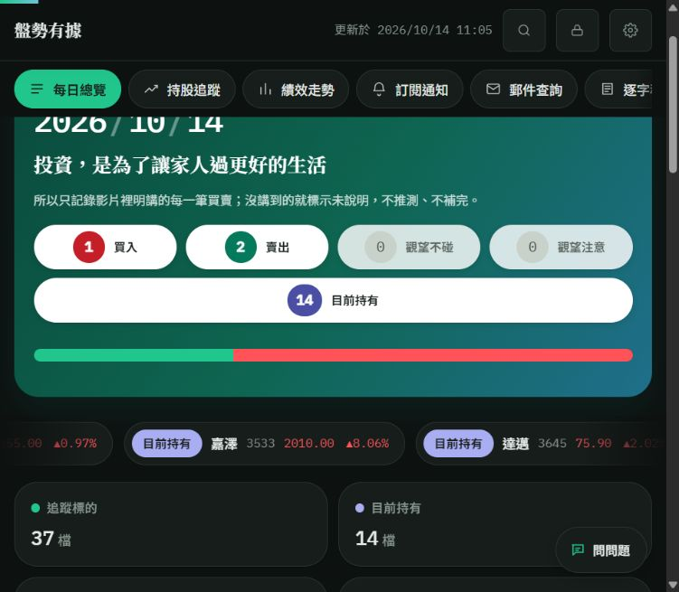
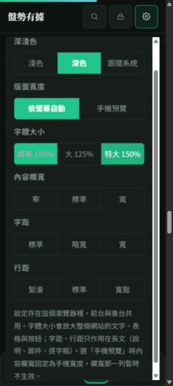

# v178–v178r5：部分賣出、可見區播放與報價接續

## 持有數為何差一檔

10/14 修正前，正式總覽為14檔，持股追蹤為13檔，集合差異只有嘉澤3533。09:30的操作原文明確區分「指定成本部位賣出」與「另一部位續抱」。解析已記下部分賣出及續抱，回合程式卻把所有賣出都當作整檔結束；首頁另外補回續抱，因此兩處不同。

- 明確寫部分部位、部分賣出、減碼、減持時，保留原持有回合。
- 全部、全數、清倉、出清優先，仍結束回合。
- 沒有既存部位或持有依據，不憑部分賣出建立部位。
- 不知道張數，不推算剩餘成本與部分已實現報酬；原進場基準維持。
- 總覽依代號去重；重算改清除實際使用的首頁快取鍵dash_v94。

## 正式資料修正與驗收

1. 10:34執行唯讀auditPartialSaleHoldings178：嘉澤32筆紀錄，保留8/12開始的回合，原進場1987.5，沒有整檔出場。
2. 10:36執行repairPartialSaleHoldings178：在原試算表建立「持股備份_1014_v178」，再只用現有日K重算。37檔，71個進出場價核對，0個公式不符，約7秒。
3. 正式總覽、統計、持股追蹤與後台持有按鈕均讀回14檔；前台平均報酬計算標示14／14。
4. 未重判每日文章、未改原始操作資料；沒有重寄Email／LINE。

## 自動播放

十八張主圖進入可見區後本機循環播放；圖卡仍有可見部分就維持播放，完全離開才暫停；持股回合沿六個原有日期循環，第一回合結束後才呈現第二回合。示意曲線明示不是真實行情或績效。

- 點情境、拖動或輸入後停止；返回該區塊不搶回控制。
- 「再播圖解」及原播放按鈕可以主動重開。
- 離開可見區、切分頁、背景頁暫停；減少動態時不自動播放。
- 詳細模式的持股播放器、五站流程、代理查詢圖與載入比較也使用可見區播放。
- 本機逐一檢查18張主圖都推進，動畫期間0新增API請求。
- 正式站實際看到持股日期推進至9/01；展開後點暫停，步驟停在2，隔次讀回仍為2。

## 報價為何一直待更新

三個層次分開處理：

| 阻點 | 修正 |
|---|---|
| MIS當次沒有成交價，逐檔備援每次最多四檔 | 共用佇列收到結果就接續，只補缺值或過期股票，最多四輪 |
| 同一組查詢被前端及Worker保存60秒，補查可能回放舊結果 | 報價取消這層結果快取；同時讀取仍共用在途請求 |
| 返回已載入的分頁原本等待每分鐘刷新 | 切回總覽／持股立即核對；後端兩種共享快取一次getAll讀取 |

保留後端五分鐘新鮮度檢查、60秒個股即時快取及來源跨執行限速。來源失敗停止連續重試；過期價位不顯示為現價，不拿委買委賣推估成交。

### 實際量測，不混用快取與冷讀

均為2026/10/14盤中正式站／正式API，不是模擬。

| 樣本 | 結果 |
|---|---|
| 修正前14檔API一批讀取 | 6.97秒；並非所有價位在讀回時都新鮮 |
| 中間版正式首頁暖讀 | 0.81秒，15檔完整 |
| 中間版正式首頁部分補查 | 15秒仍差勤誠一檔；保留失敗紀錄 |
| 中間版修正結果回放後暖讀 | 1.32秒，15檔完整 |
| 持股頁暖讀 | 0.56秒，14檔完整 |
| v178r3正式API冷讀一批15檔 | 12.95秒，GAS約12.29秒；仍有過期列，不能稱完整 |
| v178r3正式首頁開頁及接續補查 | **6.20秒，15檔完整**；1.03秒時還有7個價格元件未齊，6.20秒歸零 |

完整判定是頁面所有可見卡片與行情列均有數字，沒有「待更新／前次行情／—」。15檔共37個重複元件（含循環行情列）逐一核對，同檔價格0不一致。量測期間也有一輪15秒整批尚未返回；**15秒是目標，未證明所有冷讀皆達標**。沒有把暖讀1.32秒與冷讀6.97秒硬算成提升百分比。

成交值採lastTrade.price／closePrice，漲跌幅用同一成交價與前收盤計算；富果文件將lastPrice標成含試撮，不能直接替代真正成交。[官方欄位定義](https://developer.fugle.tw/docs/data/http-api/intraday/quote/)

## 版面設定字級（r4／r5）

設定標籤與選項由13.5px提高至15.5px，選單標題17px，補充說明14.5px，均沿用使用者字級倍率；按鈕至少44px高。前後台共用Stylesheet，沒有更改已儲存的100%／125%／150%選擇。正式站360px實測：標準標籤與按鈕15.5px，特大23.25px，按鈕至少44px；標準與特大均無整頁或選單橫向溢出，測後還原標準與原視窗尺寸。

## 測試與部署

| 元件 | 版本／驗收 |
|---|---|
| Apps Script原專案／原exec | v178r5，版本465；部署後ping讀回補記 |
| GitHub Pages | 本輪程式提交待補；發布成功後補記 |
| 網站API Worker | site-api-v178-r1；版本77c3ee86-6edb-4b05-a506-b55ba738a63c，原五分鐘cron維持 |
| 原始操作與通知 | 未重寄；部分賣出只修正派生持有回合 |

- check_partial_sale_rounds.js：15個部分／全部、既存／無部位、後續全出案例通過。
- check_tech_autoplay.py：1440／390px，六步循環、點擊停止、返回停止、重播、切頁停止、減少動態；1280px18張主圖推進且無新增API請求。
- check_story_redesign.py與check_tech_story.py：五種寬度、深淺色、閱讀模式、錨點、無JS及原案例通過。
- check_agent_chapter.py、check_source_cards.py：六情境、鍵盤、來源連結與停止播放通過。
- check_quote_display.js：共用行情、漲跌參考、拒絕舊回應、遮蔽過期數值通過。
- check_quote_queue.js：合併呼叫、4／8／12逐步補齊、只補缺值、最多四輪、失敗及背景停止通過。
- check_quote_relay_fresh.mjs：同時讀取一個後端請求，下一次讀取新結果通過。
- check_quote_batch_fairness.js：12檔不反覆補前四檔，較新表格報價優先通過。
- check_quote_flow.js：12種整日／收盤／隔日／來源故障情境通過。
- check_original_parity.py：30公開／60後台方法一致。
- tests/test_site_api.mjs：來源、權限、允許方法及轉送通過。
- 舊test_site_api_v107_snapshot.mjs第55行未通過；修改前f49b0ad相同失敗，該檢查假設與後來validatedAt快照規則不一致，本輪未更動該規則。

checkProjectFiles於11:09確認v178r3，24個gs／10個html全部正常；r4增加共用設定字級，r5修正點再播後低於25%可見而提前停止，正式結果再補記。

## 正式截圖

## 回退

回退本輪Git提交與部署版本；報價Worker可退回既有部署。持股備份可恢復派生表，但不能重新把部分賣出解讀為全數出場。仍未知的張數、部分實現報酬及服務尖峰冷讀時間，未宣稱已驗證。
