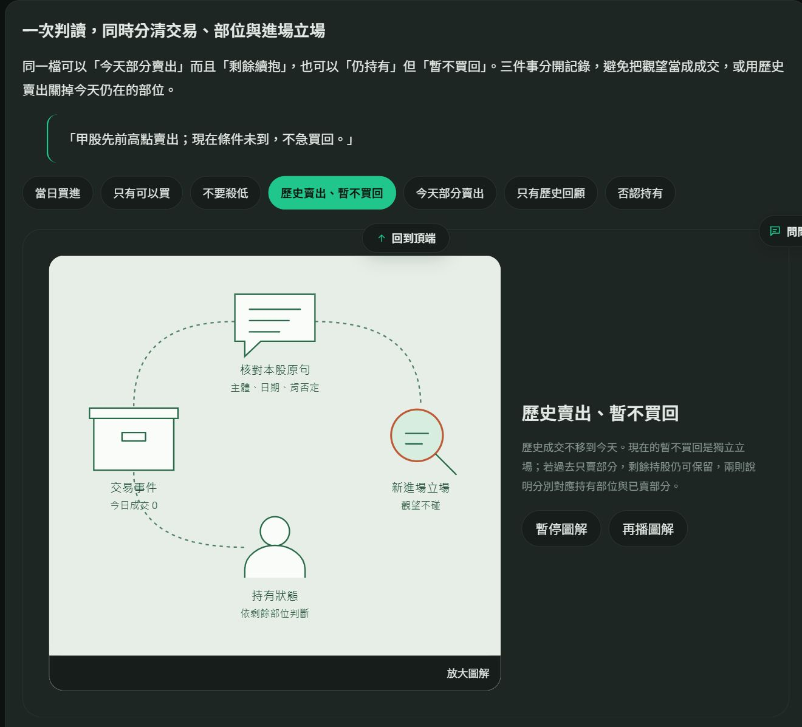

# v189：主題圖像、合章與分類邊界

## 範圍與來源

- 正本：`public-site/gas-source/`。修改技術頁、前端互動與版本標記；沒有修改分類引擎、正式個股資料、寄送帳本或觸發器。
- 第二、三章合為「資料流向與單日實例」，共19章。`#tech-day` 保留，位於 `#tech-overview` 內；六階段與34節點關聯圖、單日動線按鈕仍可互相連結。
- 原有595個內容識別均保留；核心說明、案例、來源及章末導覽保留。只精簡重複導讀，調整合章標題與編號。

## 圖像與互動

| 主題 | 呈現與可觀察結果 |
|---|---|
| 資料與實例 | 網路圖與日期時間線；同章直接切回關聯圖 |
| 快取 | 手機、資料庫與試算表；命中走直接回傳支線，未命中才回源；未走支線的文字仍可讀 |
| 模型容量 | 單次輸入32,325／1,048,576＝3.08%；輸出5,379另計，19次累計不當作同時占用 |
| 原理問答 | 容量、切詞、推論、工具、隔離及替換六種圖解；切詞保留原有可點小單位／編號／向量圖 |
| 候選與硬傷 | 漏斗、來源文件、隔離支線；20／1／19明示是教學數量，非當日稽核統計 |
| 歷史通知 | 日期軸與固定日期點；請求圓點移動，日期本身不移動 |
| 部位 | 全部／部分出場支線；持有與新進場立場分開 |
| 圖面控制 | 滑入播放，選項停止該圖，再播恢復循環；離屏、背景頁及減少動態限制依原控制器處理 |
| 放大 | 使用目前選項及目前手機／桌面布局的SVG；附目前案例說明，關閉按鈕不拆字 |

二十張主圖不再共用四格文字模板。原有十三張雙欄來源卡、三張歷史介面截圖保留；截圖不是即時報價。

## 分類、歷史回顧與投票補充

對照 `docs/分類裁決基準.md` 現行順序及 `pipeline/pipeline.py` 的 `verdict_class`、`verdict_settle`、直接判讀覆核與後續處置。這一輪補說明與教學情境，沒有改變引擎。

### 七個分類邊界情境

1. 今日已買進：核對本人／會員、日期及已執行；有效當日指令另依完整原文核實。
2. 只有可以買：屬可買建議或買點條件，列注意，不憑此建立成交與成本。
3. 不要殺低：反對賣出，不是當日賣出，也不能反推為今日買入或禁止買進。
4. 歷史已賣、暫不買回：今日成交為0；當下禁買可列不碰，剩餘持股另判。
5. 今日部分賣出：保留剩餘回合；全數出場才關閉整檔。
6. 只有歷史回顧：不是固定偏多或偏空分類；有新的本股立場才另行評估。
7. 否認持有：不建立本股部位；沒有持有不等於不能買，鄰股的持有不能挪用。

另列注意、不碰、持股、不公開及內容驗收等價的明確邊界。情境使用虛構甲股，不公開私人通知價位。

### 七個有效票情境

- 第一張有效票與流程一致：可停止詢問。
- 注意／不碰互換：兩張有效票支持同向。
- 一般跨公開或涉及部位的改列：三張有效票一致。
- 已核對未出場部位：兩張持股票可適用紀錄支持例外。
- 引句不屬本股或無法對回：不計票；三次無效仍是0有效票。
- 三輪仍分歧：未定，按原句支持與公開門檻處理；不一律保留，也不一律刪除。
- 問卷票多但沒有成交證據：不得創造今日交易、成本與部位。

同輪合併爭議股票，最多三輪是單次流程上限，不是全天上限，也不是三位獨立專家。補收例外、人工與硬紀錄、裁決版本／指紋、無來源及寫入失敗的停止條件另有明文。

## 驗收

- 靜態關卡：595項識別、19章、舊錨點、13來源卡、20主圖、3案例模組、直接include及JavaScript語法通過。
- 原始介面橋接：30個公開及60個後台方法對齊。
- 本機逐章：390淺色、1440淺色、1916深色特大150%、360深色特大150%。首輪1440工具圖抓到一行裁切，已加高至780並重驗；正式1440全章無裁切。
- 十四個新增情境：桌面、390特大字逐項切換，文字沒有超出圖面。正式390逐項確認選項、結果、手動停止。
- 正式逐章：1440與390各19章，無水平溢出、無圖中文字超出；三張延後載入圖片另實際展開確認，原寬2480、1249與1320。
- 原有九個候選／硬傷／歷史案例及六個AI原理切換已檢查；正式六階段選擇、34節點數及時間線影片按鈕連回詳情正常。
- 本機新增定義圖重播後連續三個循環；放大視窗顯示目前「否認持有」圖與完整解釋。
- 量測原始檔：`tech-redesign-20261016/v189-browser-measurements.json`。延後載入尚未請求的圖片不當作遺失，另列實際載入結果。

## 部署與限制

部署與最終正式讀回結果在下方補記。減少動態、無JavaScript與列印本輪以原有支援及靜態契約核對，沒有重做作業系統設定或停用瀏覽器JavaScript。頁面圖解不呼叫模型，也不驗證未來模型零誤判。

回退：還原本輪前端提交，原部署可切回489（v188）；不需要還原股票資料或寄送紀錄。

### 最終部署讀回

- 前端提交：`0329817`，另以 `30639e9` 去掉重複說明，`dee442c` 區分時間線固定日期點及移動圓點。
- Pages：執行 [38916574773](https://github.com/Lee200202/Stock/actions/runs/38916574773) 成功，來源 `dee442c`；正式站讀回 `data-tech-book=v189`、19章、完整圖文與新情境。
- 原 Apps Script：擁有者編輯器更新原部署成功，490版（10/16 22:34）。未另建新部署，也未更改執行身分及存取設定。
- `/exec?action=ping`：`ok=true`，build `2026-10-16-tech-illustrations-v189`。
- 重新拉回不可變490版：44個雲端檔，37個Git共用來源全部一致，`differs=[]`；7個雲端額外編輯／覆核檔保留。
- 正式手機19章、14個新增定義／票數案例及6個AI原理選項均讀回；最新歷史圖為3個固定日期點及1個移動圓點。
- 原Web App的瀏覽器仍被Google導向「很抱歉，目前無法開啟這個檔案」。因此部署與程式一致性已確認，但原Web App視覺驗收受限；不可將Pages畫面冒充原Web App畫面。
- 本輪沒有執行模型、單日更新、股票資料寫入或通知寄送。

