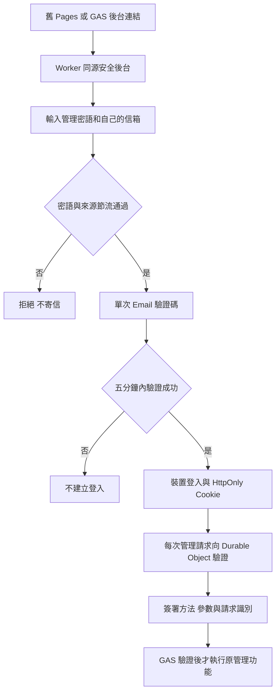

# 後台登入與裝置安全：隔離建置及啟用驗收

日期：2026/11/05。基準：main `001d998c09eeebf67af090ae823b15851c8646af`。

狀態：使用者已要求開始更新，候選進入發布準備；安全登入維持關閉，尚未更換正式密鑰。以下驗收分別記錄程式發布、擁有者部署與正式啟用，不能混為同一狀態。

## 已核定的登入方式

使用者明確選擇：同源安全後台，保留舊連結引導；人工管理密語加 Email 驗證碼；陌生登入者填自己的信箱，**任何能收碼的信箱皆可登入，無名單、無核准步驟**。信箱證明收信能力，主密語仍是申請完整管理權限的資格。

不使用 TOTP，不將 OWNER_EMAIL 當唯一收件人，不寄碼給訂閱名單。新登入不會新增訂閱、寄送每日整理信或操作 LINE。這是依最新裁示建構，不把先前「指定信箱／白名單」提案當定案。

## 期限與使用方式

| 情境 | 本版處理 |
|---|---|
| 公用登入 | 預設；最長三十分鐘，沒有持久信任 Cookie |
| 個人信任 | 需主動勾選；最長七天，恢復不延長原七天期限 |
| 閒置 | 後端十五分鐘不接受管理請求；前端另有本機鎖定計時，背景輪詢不續期 |
| 恢復信任 | 使用者明確點「繼續使用這台裝置」，原子輪替舊信任憑證；不算敏感操作的重新驗證 |
| 敏感動作 | 查看完整 IP、撤銷一台或其他所有裝置，需要五分鐘內完整手動密語及 Email 驗證 |
| 重新申請驗證碼 | 同信箱六十秒一次、每小時五封；全站每小時最多二十封 |
| 錯碼 | 每份挑戰最多五次，五分鐘到期；成功即消耗，不能重用 |
| 信任輪替回覆遺失 | 不設可重放舊憑證的寬限；可能需重新手動驗證。先保留失敗安全，不宣稱網路重送完全無感 |
| 撤銷 | 一併使該瀏覽器全部登入與信任資格失效；下一個新受理請求拒絕，不取消已受理背景工單 |
| 自行重新登入 | 撤銷後仍可再手動輸入正確密語並完成新 Email 驗證；符合本次需求，不是永久硬體封鎖 |
| 舊瀏覽器密碼管理員 | 本站無法遠端清除。新版不再寫 zzAdminKey；切換須輪替舊共用密鑰 |

登入驗證信會消耗 MailApp 收件額度；不是 Gemini 額度。寄碼預設保留二十個收件額度，額度不足或寄送失敗就不建立登入。二十不是所有每日信件量的保證，正式啟用前須核對實際訂閱數及當日待送量。寄送服務接受也不等於收件匣已收到。

## 程式變更矩陣

| 檔案／元件 | 內容 |
|---|---|
| `site-api/admin-security.mjs` | Durable Object 強一致登入權威；Cookie、密語驗證、一次性碼、期限、撤銷、節流、加密 IP、事件清理 |
| `site-api/admin-router.mjs` | 僅列明的同源端點；Origin／JSON／CSRF；內部簽章端點不對瀏覽器開放；最多 64 KB |
| `site-api/worker.mjs` | 公開 API 維持原流程；啟用後拒絕舊 `/api` 人工管理；新增獨立管理路由 |
| `site-api/wrangler.jsonc` | SQLite Durable Object 與靜態資產綁定；**預設 ADMIN_SECURITY_ENABLED=false**，不因程式存在即自動啟用 |
| `Adminauth.gs` | 驗內部簽章、方法、參數、時間與重放；只寄本次申請的驗證碼；編輯器啟用函式以下劃線結尾，不暴露為 google.script.run |
| `SiteBridge.gs`、`Adminservice.gs` | 啟用後只接受經 Worker 核實的執行期上下文；瀏覽器不能自行拼物件或帶舊 ADMIN_KEY 繞過 |
| `API.gs` | 兩支原本各自比較共用密鑰的管理方法改用同一驗證；機器刷新入口保留獨立服務密鑰檢查 |
| `AdminSecurity.html`、`Admin.html` | 原完整後台加安全登入與「自動化監控 → 登入與裝置」；原複核編輯功能仍在；不改成簡化後台 |
| `Code.gs` | 啟用後原 GAS 管理入口提供前往同源後台的明確引導 |
| `original-bridge.js` | 安全管理呼叫走同源 Cookie；相容 KEY 只是字面占位，不再是授權依據 |
| `build_secure_admin.py` | 由同一份 Admin 正本組裝 Worker 靜態頁；不包含真實秘密、不呼叫 API |
| `configure_admin_security.py` | 擁有者本人在本機輸入新密語；經 stdin 設 Worker Secret，不寫秘密檔案、不把秘密放命令列；偵測已設資料加密金鑰即停止，避免重跑破壞舊 IP 解密 |

只保存登入所需與管理者同意的連線資訊。裝置 ID 為隨機記錄 ID，不是硬體 ID。概略地區由 Cloudflare 連線資訊提供，缺少則顯示未提供；不讀本機檔案、GPS、MAC、Google 帳號或其他網站紀錄。IP 以 AES-GCM 加密，金鑰放 Worker Secret；完整 IP 七天後拒絕讀取，清理排程移除加密內容。事件九十天後清理。平台排程延遲與已讀取資料無法收回，不能宣稱精確到秒的實體抹除。

安全事件不記密語、驗證碼、Cookie 或整份請求。一般唯讀輪詢不灌入安全事件；敏感管理受理、登入、錯碼、撤銷等才記錄。簽署受理表示驗證已通過，不表示後續資料寫入必定成功。

## 本輪已做的驗收

| 層次 | 實際證據 | 結果與限制 |
|---|---|---|
| 核心安全契約 | `node --test scripts/test_admin_security.mjs` | 36 項全過；記憶體儲存及假郵件傳輸，不能冒充真實收信 |
| UI 程式與相容性 | `node scripts/check_admin_security_ui.cjs` | 六個原始 script 區塊可解析，同源、活動、無 emoji 與不存密語檢查通過；不代表版面或操作已看過 |
| 原始橋接對齊 | `python -B scripts/check_original_parity.py` | 30 個公開、62 個管理方法對齊 |
| 專案 manifest | `node scripts/check_project_manifest.cjs` | 四項版本與真實 HTML 契約通過 |
| 公開內容保留 | `node scripts/check_source_fidelity.cjs` | 九項既有契約通過 |
| 原複核與修改功能 | `node scripts/check_review_history.cjs` | 37 項既有契約通過 |
| Worker 打包 | Wrangler deploy `--dry-run` | 新 DO、資產及原 KV／cron 綁定可打包；沒有建立雲端資源或更新部署 |
| 本機真實 workerd | 隔離的本機 Worker、SQLite DO、假郵件與假資料服務 | 密語→寄碼→Cookie→裝置讀取及改名→簽章 RPC→登出後拒絕全鏈通過；PBKDF2 600,000 次可在此執行環境執行 |
| 瀏覽器 HTTPS | `https://127.0.0.1:8766/admin/` | 自簽憑證遭瀏覽器拒絕，沒有繞過警告；桌面／手機／深淺色與真實編輯操作尚未驗 |
| 正式網站／Email | 未操作 | 沒有正式寄碼、沒有換密語、沒有部署／推送，也沒有改帳本或每日排程 |

測試涵蓋：單次碼、過期、五次錯碼、跨瀏覽器盜用、重寄節流、郵件失敗、密語錯誤、Cookie 屬性、輪詢不續期、三十分鐘絕對期限、七天不滑動、閒置恢復、舊信任不可重放、恢復不等於敏感重新驗證、單裝置／其他裝置撤銷、裝置 ID 不是授權、登出後舊 Cookie 拒絕、認證版本輪替、IP 加密／保留、事件清理、CSRF、Origin、內部簽章端點不可公開、舊 Pages API 關閉、缺綁定失敗安全、RPC 固定名單、參數與主體完整性及 GAS 重放阻擋。

追加三項：兩個同時信任恢復只有一個後繼成功；撤銷排在受理之前的請求必須被拒；GAS 郵件額度低於保留量時不得呼叫寄送。既有 Pages CI 已加上同一離線入口；目前沒有推送，所以尚無這一版的雲端 CI 成績。

本次開始發布前再補兩項：安全登入切換後，既有 day-sync 機器入口須繼續可用，且服務密鑰仍不能直接登入後台；未啟用時可讀取空的登入介面，但管理 API 必須維持拒絕。原先只改共用 adminAuth_ 會誤擋 day-sync，已改由固定機器路由建立執行期上下文，回應前清除；不替任意方法兌換服務密鑰。寄碼的二十份額度保留界線改為「剩餘二十或更少就不寄」，避免寄完只剩十九份。

本輪抓到並已修正：內部 `/admit` 不能被公開路由透傳；Cloudflare 概略位置須由入口覆蓋而非信任來客標頭；已登出的個人裝置不能被 KPI 計成有效登入；二十四小時失敗計數不能只數畫面最近二百筆；本機 dotenv 雙引號 JSON 格式與真正 Secret 的格式不同，已修正隔離環境設定，不降低密語成本。

## 正式啟用前，擁有者需要親自完成的步驟

這些步驟尚未執行。真正的新密語、機器密鑰、閘道秘密或驗證碼**不要貼進 AI 對話**。

1. 先完成候選審閱、正常回歸與瀏覽器測試。核對原本後台的十個分頁、複核編輯、日期、匯出都保留。若正式瀏覽器測試需暫存隔離環境，明確保持與正式資料、真實寄送分離。
2. 確認 Cloudflare 帳號實際方案允許 SQLite Durable Object，資源、儲存與 CPU／請求量可承擔。`--dry-run` 只能證明打包，不能當作雲端帳號驗證。不要因本功能自行升級付費方案。
3. 擁有者產生一組新的機器密鑰，同步 GAS 的 `ADMIN_KEY` 與 GitHub／其他授權機器端的對應 Secret。檢查 `pipeline/pipeline.py`、所有含 `ADMIN_KEY` 的 workflows、備份／日同步工具及私有排程設定；不要只改 GitHub 一個地方。曾經保存在瀏覽器的舊密鑰必須作廢。這一步只由擁有者操作，不在本機文件留下值。
4. 在 GAS 設 `ADMIN_MACHINE_KEY_ROTATED=true`，只在上一步真的完成後設定，不能為了通過程式而先填。若同步漏掉，自動化會失敗；應先在無害診斷確認機器通道，再切人工登入。
5. 擁有者準備獨立的 64 位小寫十六進位隨機 `ADMIN_GATEWAY_SECRET`，僅設在 Worker Secret 與 GAS Script Property。不要拿人工密語或已暴露的舊密鑰充當它。
6. 擁有者執行 `scripts/configure_admin_security.py --wrangler <本機 wrangler.js 路徑>`，親自輸入新人工密語與同一閘道秘密。它只設三個 Worker Secret，不會幫您輪替機器密鑰、部署或啟用。首次設定工具偵測已存在 `ADMIN_DATA_KEY` 即停止；後續改密語需保留這個 IP 加密金鑰。
7. 發布本次已驗證來源至原 GAS 部署與 Worker，Worker 維持 `ADMIN_SECURITY_ENABLED=false`。原 GAS 最後部署若仍受擁有者網域限制，沿原網址由擁有者切版本；不能另外建一個新的正式網址或把「建立版本」當作已部署。
8. 完成核對後，在 GAS 編輯器由擁有者執行 `enableAdminSecurity_()`，再將 Worker 設定 `ADMIN_SECURITY_ENABLED=true` 並發布同一份候選。兩處閘道必須一致；不同步時會暫時拒絕人工登入，不能退回舊密鑰。**第一版候選目前預設 false，尚未執行這一步。**
9. 擁有者在新安全網址本人輸入人工密語及自己的信箱，確認只寄一封、五分鐘有效、實際信箱收到；回填驗證碼。過程不讓 AI 讀密語、Code 或完整 Cookie。
10. 用第二個隔離瀏覽器／無痕設定檔完成另一次登入；第一台撤銷第二台，測第二台讀、無害寫入測試物件、重新整理及信任恢復均被拒。不能為測試更動正式股票、部位或寄送帳本。
11. 驗證舊 Pages、舊 GAS 直接 API、偽造物件／舊 ADMIN_KEY 都不能取得管理資料；舊連結可順利引導。再驗目前複核卡、編輯、MD 匯出與設定在新同源頁正常操作。
12. 讀回正式版本、狀態與下一輪既有排程。沒有新增另一套每日排程，沒有重寄每日 Email／LINE；正式成功後才將本紀錄改成已啟用。

如果正式切換失敗，優先關閉人工管理入口、保留獨立機器排程及已驗證的資料，不恢復曾在公用瀏覽器保存過的舊共用密鑰。若遺失人工密語，從擁有者的雲端控制權更新密語驗證器並提升 `ADMIN_AUTH_EPOCH`，不要新增「任意信箱單獨找回完整管理權」的旁路。

## 未結事項

- 正式部署、擁有者憑證設定與真實收碼尚未執行。
- 瀏覽器視覺、鍵盤、手機 390 與深淺色尚未驗收，不以 script 可解析冒充。
- 生產 Cloudflare 方案、雲端 DO 建立、真實 IP 與城市來源尚未驗；不能填猜測位置。
- 尚未提供安全事件日期區間篩選／匯出或多管理者角色；本版列最近二百筆及裝置管理。這些不影響後端的登入撤銷，但與總覽書的完整畫面構想仍有差距。
- 既有管理頁仍有 inline script／handler，CSP 為相容現有介面保留 inline；HttpOnly 不能防止 XSS 代替使用者操作，不宣稱已完成全面 XSS 防護。
- 目前仍有機器網址以 query string 傳服務密鑰的既有用法；本版要求先輪替並與人工分離，後續應再遷移為簽署的服務請求。不能把這項未改的傳輸說成已完成。
