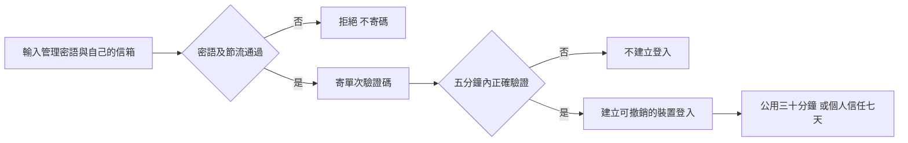
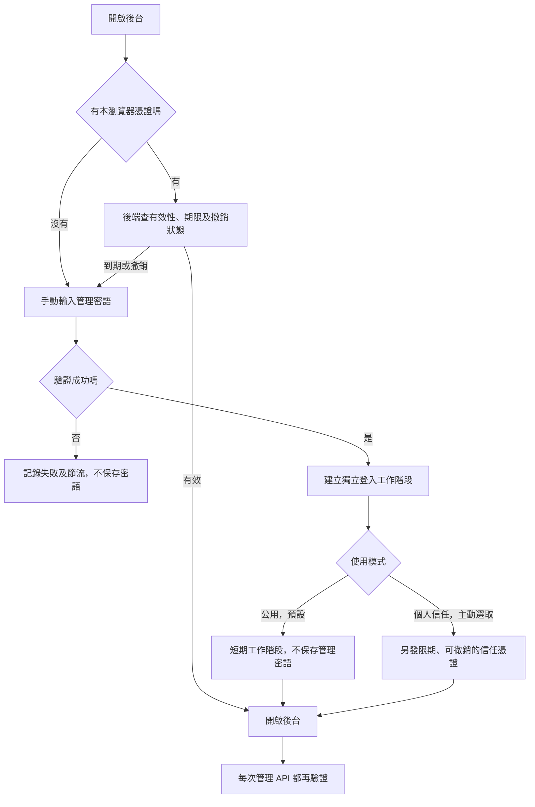
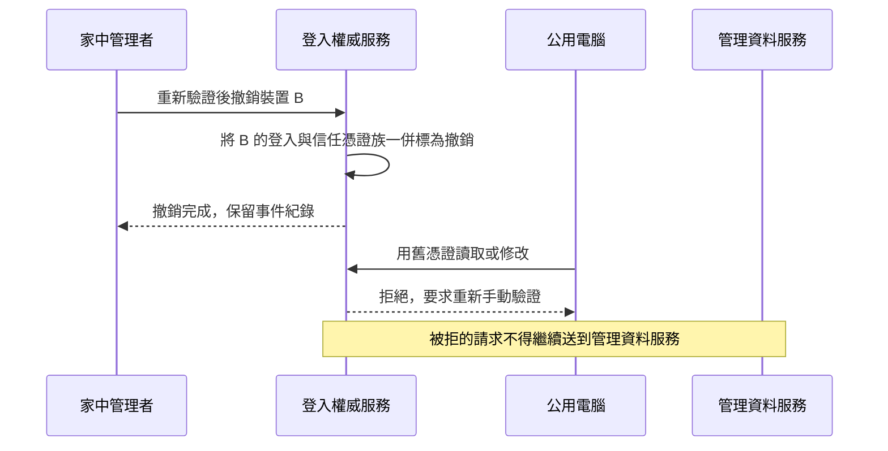

# 盤勢有據｜後台登入安全與裝置管理規劃總覽

日期：2026/11/05，台北時間

狀態：登入政策已核定，已開始隔離建置；尚未部署或改變正式登入方式。
查核基準：main `001d998c09eeebf67af090ae823b15851c8646af`。本輪只讀程式及官方技術文件，沒有讀取瀏覽器保存的密鑰、蒐集真實 IP 或操作真實登入撤銷。

## 一、先說結論

可以做出類似「已登入的裝置」管理頁，顯示瀏覽器、登入時間、最後使用、IP 與概略地區，並從另一台電腦撤銷其登入。但核心必須是「伺服器可撤銷的登入憑證」，不能只增加一張登入紀錄表。

建議第一階段：管理者仍可手動輸入管理密語；驗證後，每個瀏覽器取得獨立的登入憑證，不再把管理密語存進 localStorage。公用電腦預設不記住；個人裝置可選擇限期信任。按下撤銷後，後端拒絕那個瀏覽器的舊憑證，下一次必須重新手動驗證。

這不代表能遠端抹除公用電腦硬碟、清除它的瀏覽器密碼管理員，或收回已經看過、下載的資料。若有人已取得真正的管理密語，單純撤銷裝置不足以阻止他再輸入密語登入，須更換登入密語，必要時增加第二步驗證。

本書的圖、API 名稱、期限與資料欄位須與下列核定政策一起閱讀；尚未表示正式網站已啟用。

### 2026/11/05 管理者核定

- 公開網站維持原址；安全後台與管理 API 採既有 Worker 同源，舊連結保留引導。
- 人工登入先輸入管理密語與登入者自己的 Email，再輸入六位驗證碼。
- 不設信箱白名單、不等待擁有者核准：任何信箱能收碼成功，且持有正確管理密語，即可取得完整管理權限。這是管理者明確選擇的授權模式。
- 信箱是本次收信能力的驗證與登入標示，不代表管理者事先認可的個人身分。主密語仍是能否申請管理登入的核心資格。
- 信任裝置最長七天；公用模式最長三十分鐘；閒置十五分鐘鎖定。敏感動作要求五分鐘內的完整手動驗證。
- 完整 IP 邏輯存取期限七天，安全事件九十天；後台按期限拒絕讀取，另由權威服務定時清理。
- 驗證碼五分鐘、單次有效，最多五次輸入；同一信箱六十秒內不重寄、每小時最多五封，全站登入寄碼每小時最多二十封。預設保留至少二十個 MailApp 收件額度，額度不足即停止登入寄碼，不放行登入；這個保留量不能代表足以承擔所有當日訂閱，啟用前須對照實際寄送量調整。
- 正式切換前必須輪替曾供瀏覽器保存的舊共用密鑰，並同步機器排程 Secret；舊密鑰不能留下另一條刷新或管理旁路。
- 不自行寄送測試驗證信給訂閱者；正式驗證碼由管理者本人按登入申請觸發。



## 二、現況查核：問題確實存在於哪裡

| 現況 | 已核對的來源 | 實際意義 |
|---|---|---|
| 記住登入時保存管理密鑰本身 | `public-site/gas-source/Admin.html`，`STORE='zzAdminKey'`、`saveKey()` | 目前不是保存可單獨撤銷的裝置憑證 |
| 開頁自動讀取並登入 | 同檔 `loadKey()` 與開頁 `doLogin()` | 同一個瀏覽器設定檔的下一位使用者，可能直接進後台 |
| 登出會清記憶體中的 KEY，但沒有同時刪除已記住密鑰 | 同檔 `logoutBtn` 處理程序 | 「登出」與「忘記此裝置」目前是兩件事，登出後仍可能保留自動登入能力 |
| 忘記裝置只刪本機儲存 | 同檔 `forgetBtn`、`clearKey()` | 不能從家裡撤銷另一台電腦已保存的密鑰 |
| 後端以共用 ADMIN_KEY 比對 | `Adminservice.gs` 的 `adminAuth_()`、`apiAdminLogin()` | 沒有獨立的瀏覽器登入狀態、到期時間與撤銷清單 |
| Pages 管理請求傳遞相同管理密鑰 | `site-api/worker.mjs`、`SiteBridge.gs` | 撤銷不能只做在前端，Worker 與 GAS 都須防止舊入口繞過 |
| 自動化刷新也使用 ADMIN_KEY | `pipeline/pipeline.py`、`.github/workflows/daily.yml` | 不能直接換掉或停用這個密鑰而不安排機器端遷移 |
| 已有使用分析會記錄前端登入動作 | `Admin.html`、`UsageTracker.html`、`UsageAnalytics.gs` | 它是使用行為資料，不等於伺服器核實的登入安全日誌，也不能拿訪客 ID 當授權 |

這是從程式確認的風險，不是判定已有人入侵。沒有執行猜密碼、讀他人裝置或攻擊測試。

新清單只能可靠記錄功能啟用後的登入。舊版沒有建立這種安全事件，不能補猜歷史裝置、IP或位置；初次切換要求所有人工管理者重新驗證，也不把「清單尚無紀錄」解讀為沒有其他電腦保存過舊密鑰。

## 三、能收集哪些資訊，不能收集哪些資訊

### 建議顯示與用途

| 欄位 | 建議內容 | 可信度及限制 |
|---|---|---|
| 瀏覽器紀錄 ID | 系統隨機產生，列表顯示短碼，例如「裝置 A7F2」 | 不是硬體序號，不是登入密鑰，也不是授權依據 |
| 裝置名稱 | 自填「家裡桌機」「公用電腦」 | 方便辨識，不能依名稱判斷安全 |
| 系統及瀏覽器 | Windows／Chrome、iPhone／Safari；能取得時顯示主要版本 | 依請求資訊推估，可被偽裝或缺少，未知就標未知 |
| 首次登入 | 後端成功建立登入時的時間 | 畫面用台北時間，儲存採 UTC，避免本機時間造假 |
| 最近登入 | 最近一次手動驗證成功 | 與背景續期、最後使用分開 |
| 最後使用 | 最近一次已通過驗證的管理活動 | 背景輪詢另記，不能每分鐘輪詢就顯示人在操作 |
| 最近背景連線 | 狀態輪詢或心跳的最後時間 | 只能叫近期連線，不能叫真人在線 |
| 登入 IP／最近 IP | 由入口伺服器取得，列表先遮罩 | IP 可能動態變更，同個 IP 也可能多人共用 |
| 概略地區 | 國家、地區、城市；資料缺少時標「未提供」 | IP 推估，不是 GPS，不是街道、住址或精確實體位置 |
| 登入入口 | 新安全後台、舊入口轉入等 | 有助發現漏掉的旁路 |
| 登入方式 | 手動密語／信任裝置恢復／未來 Google 驗證 | 「信任恢復」不是重新輸入密語 |
| 使用模式 | 公用／個人信任 | 由管理者選擇，不自動假定電腦是私人的 |
| 狀態 | 有效、閒置鎖定、已登出、到期、已撤銷 | 都以後端狀態為準 |
| 到期時間 | 本次工作階段與信任期限分開 | 即使 Cookie 還在，也不能超過後端期限 |
| 安全事件 | 登入失敗、撤銷、重新驗證、修改登入設定 | 不保存輸入的錯誤密碼，也不記錄完整憑證 |

若使用共用管理密語，只能辨識「哪個瀏覽器登入」，不能可靠辨識是哪一個人。若未來有多位管理者，建議使用各自帳號與角色；自填姓名不能取代身分驗證。

### 不納入的資料

不讀本機檔案、Chrome 個人資料、其他網站登入狀態、Google 帳號紀錄、瀏覽歷史、剪貼簿、MAC 位址、硬碟序號、Wi-Fi 名稱或相簿。不做 Canvas／字型等隱藏指紋追蹤，也不申請 GPS 權限。

這套功能是記錄「進入本站後台的連線與登入」，不是遠端監看那台電腦。一般網站也無法從標準請求直接讀出電腦名稱或可靠的實體硬體 ID。

### IP 的來源與資料最小化

建議在 Cloudflare 入口擷取其提供的連線 IP 與 `request.cf` 概略地區，忽略前端自行填的 IP／城市。經其他代理或 Worker 轉送時，須先確認來源鏈，不能誤記 Google 或 Cloudflare 的轉送 IP。瀏覽器提供的語言、時區與 User-Agent 只作輔助描述。

Google 官方 Web App 事件欄位沒有提供可直接依賴的使用者 IP／任意請求標頭介面，因此原 GAS 入口不能憑空補出相同資訊。原入口若不經安全閘道，就應標示來源未知，不能拿假值填滿。來源說明見 [Cloudflare Request](https://developers.cloudflare.com/workers/runtime-apis/request/)、[HTTP headers](https://developers.cloudflare.com/fundamentals/reference/http-headers/) 與 [Apps Script Web Apps](https://developers.google.com/apps-script/guides/web)。

建議暫定：完整 IP 最多保留 7 天，之後只留遮罩；安全事件保留 90 天，過期刪除或匿名化。完整 IP 採限制存取及加密保存，金鑰與資料分開，不能只在畫面遮罩、底層永久保存明碼。第一版不蒐集經緯度或郵遞區號，也不把 IP 放進一般使用分析、公開 API、郵件或公開匯出。這些期限待您確認，不會現在開始收集。

## 四、登入機制：把密語與裝置憑證分開



### 建議第一版規則，均為待核定值

- 預設公用模式，記住此裝置不預先勾選。
- 公用模式：15 分鐘沒有有效管理活動就鎖定；本次工作階段最長 30 分鐘。逾期須重新輸入，不自動恢復。
- 個人模式：本次工作階段閒置 15 分鐘先鎖定；信任期限最多 7 天。期限內可按「繼續使用本裝置」恢復，不在開頁時完全無感進後台；高風險操作仍要求重新驗證。
- 狀態輪詢、報價、背景心跳不能延長閒置期限。前端倒數只提示，後端才決定是否到期。
- 登出：讓本次登入失效。另提供「登出並忘記此裝置」，一併撤銷信任憑證；公用模式的登出預設就是完整清除。
- 密語只在手動驗證請求中使用，驗證後清掉輸入框與程式參照，不存 localStorage／sessionStorage，也不在每次管理 API 重送。
- 裝置 ID、登入工作階段 ID 與秘密憑證是三件事；畫面只顯示不具授權能力的紀錄 ID。

建議憑證由安全亂數建立，後端只存驗證用摘要；瀏覽器使用 `HttpOnly`、`Secure`、適當 `SameSite` 的 Cookie。它能減少 JavaScript 讀走憑證的風險，仍不能防止已存在的 XSS 代替使用者操作，故同時須管制輸入、輸出、腳本來源及敏感操作。基本方向參考 [OWASP Session Management](https://cheatsheetseries.owasp.org/cheatsheets/Session_Management_Cheat_Sheet.html)。

## 五、現有架構有兩個必要調整

### 1. 登入頁與管理 API 建議同源

目前 Pages 在 `lee200202.github.io`，API 在既有 `workers.dev` 網址，原 GAS 又在 Google 網域。這是跨網站架構。

若只在既有 Worker 加 Cookie，再讓 Pages 跨站呼叫，即使加上 CORS 與 credentials，仍會遇到瀏覽器的第三方 Cookie 限制；不能保證 Chrome、Safari、手機及內嵌瀏覽器一致可用。參考 [MDN：Cookies 與跨站限制](https://developer.mozilla.org/en-US/docs/Web/HTTP/Guides/Cookies)。

**推薦：公開網站保留原網址；安全後台與管理 API 搬到同一個 Worker 來源。**

```text
公開網站：原 Pages 網址，維持不變
舊後台連結：引導到新安全後台，不在網址帶密語或登入憑證
新安全後台：既有 Worker 網址下的 /admin/
管理 API：同一個來源下的 /admin-api/
```

這是「前台入口不變、管理登入換到同源安全入口」，不需要先購買新網域，但須核對目前 Cloudflare 方案、資源與綁定是否適用。Worker 可同時提供靜態頁與程式路由；尚未替本專案建立或開啟此功能。參考 [Cloudflare Static Assets](https://developers.cloudflare.com/workers/static-assets/)。

原 `admin.html` 與 GAS `?page=admin` 保留明確導向及書籤相容；原網址不可繼續提供一條用舊管理密鑰直通的管理 API。若您要求登入後仍必須留在原 Pages 網址，須另選同源代理／網域方案並先驗證；不以把登入憑證重新塞回 localStorage 充當安全版。

### 2. 人的登入與機器排程分權

現行 `ADMIN_KEY` 同時服務人工管理及 GitHub／GAS 刷新，不能直接換掉後就假設自動化仍正常。

提案拆為：

| 類別 | 用途 | 存放原則 |
|---|---|---|
| 管理者登入密語或身分驗證 | 人工登入 | 依密語強度採安全驗證器；不發給瀏覽器長存、不提供排程使用 |
| 裝置登入／信任憑證 | 某瀏覽器的登入能力 | 獨立、限期、可撤銷；後端存摘要 |
| 自動化服務憑證 | 已授權刷新、工單與既有每日流程 | 只留伺服器 Secret，限制可呼叫方法，不因登出裝置失效 |
| Worker 到 GAS 的內部驗證 | 防止冒充閘道與修改傳輸內容 | 使用獨立伺服器秘密與可驗證的請求上下文，不傳給瀏覽器 |

人類短密碼不能只做一次 SHA-256 後當安全儲存；應採適用的密碼雜湊與成本設定。高熵隨機憑證的摘要驗證是另一種情境，不能混用。第一版是否繼續用隨機長管理密語，待您選擇登入方式。

正常管理 API 的每次請求都由 Worker 驗證登入，再帶受保護的身分、方法、參數摘要與請求識別到 GAS。GAS 保留驗證，不信任瀏覽器自填角色。內部憑證不能被用來替任意外部呼叫「注入總管理密鑰」。原 GAS 直接函式、SiteBridge 與舊 refresh 入口須逐一清點，不能只保護新畫面。

## 六、撤銷應該怎麼運作



建議使用強一致的登入權威儲存，例如 Durable Object；每個請求直接查它。既有 KV 可繼續服務公開快取，但不能把 KV 或各地記憶體快取當作立即撤銷的唯一依據。Cloudflare 明載 KV 是最終一致，其他節點可能延後 60 秒或更久才看到變更；因此不能靠它承諾「撤銷後下一個請求一定被拒」。參考 [KV 一致性](https://developers.cloudflare.com/kv/concepts/how-kv-works/) 與 [Durable Object Storage](https://developers.cloudflare.com/durable-objects/api/sqlite-storage-api/)。實作時仍須檢查現行方案與延遲，不宣稱免費或零延遲。

撤銷按鈕的明確語意：

1. 撤銷該瀏覽器全部有效登入與信任憑證，包含輪替前後的同一憑證族，不只刪一列畫面。
2. 撤銷成功回覆後新進入的管理請求，均須被拒；舊分頁可在下一次驗證回應後顯示「已由其他裝置登出」。
3. 裝置離線時，不能遠端刪它硬碟的 Cookie，但舊 Cookie 已不再具有後端權限。
4. 若有已經通過驗證、正在執行的請求，不能承諾撤銷能倒轉已接受的寫入。須以請求 ID 記錄受理先後；撤銷不取消既有工單、每日排程或通知。
5. 它之後仍可手動輸入正確密語重新登入，這符合本次要求；重新驗證建立新登入，舊憑證不能自行復活。若要永久封鎖硬體，是另一種需求，隨機瀏覽器 ID 無法可靠做到。
6. 「移除列表顯示」不等於撤銷。有效裝置不能只刪日誌就說已登出；撤銷紀錄保留供追查。

## 七、後台畫面安排

建議在「自動化監控」增加次分頁 **登入與裝置**，而不是混進一般使用分析。使用分析可放一個導覽入口，但安全資料需獨立權限與查詢。

```text
自動化監控
  流程狀態  |  登入與裝置

  有效登入 2       信任裝置 1       近24小時失敗 0       待查看事件 0
  以上為版面示意，實作不得把這些數字寫死

  目前這台裝置
  家裡桌機 · Windows / Chrome · 裝置 A7F2
  最近登入、最後使用、概略地區、IP遮罩、到期時間
  本次登入模式與信任期限
  [重新命名] [登出並忘記此裝置]

  其他裝置
  公用電腦 · 裝置 B4D8 · 最近活動 2026/11/05 HH:mm
  概略地區：台北（IP推估） · IP：203.0.113.*（示意）
  [查看安全事件] [撤銷這個瀏覽器登入]

  [撤銷其他所有裝置]

  安全事件
  日期區間、裝置、成功／失敗／撤銷篩選
  後端時間、動作、操作者驗證方式、結果、請求識別
```

設計沿用既有墨綠／深淺色、膠囊切換、自訂選單、滿版自訂日曆與手機上下卡片。使用線條 SVG，不放 emoji 或裝飾數字。狀態用顏色加文字，不只靠紅綠。撤銷以頁內自訂確認呈現，清楚寫影響哪個瀏覽器、是否包含信任登入，完成後重新讀回。

敏感動作建議要求最近 5 分鐘內重新輸入密語或完成強驗證，並防止重複送出：撤銷其他裝置、查看完整 IP、變更安全設定與未來新增管理者。對應 [OWASP Authentication](https://cheatsheetseries.owasp.org/cheatsheets/Authentication_Cheat_Sheet.html) 的敏感操作重新驗證方向。

不顯示完整憑證，不提供「查看密碼」。匯出安全日誌如有需要，預設只含遮罩 IP 與非機密紀錄 ID，另顯示保留期限；不把真實安全資料自動送給分類模型或其他 AI。

## 八、最低必要資料模型與 API 契約

以下只定義責任，不提供可直接部署的實作。

### 資料分成四種

| 資料 | 核心欄位 | 不能混淆的事 |
|---|---|---|
| 瀏覽器裝置紀錄 | 隨機 device_id、顯示名稱、建立時間、系統／瀏覽器摘要 | 不持有秘密；清 Cookie 後可能成為新紀錄 |
| 登入工作階段 | session_id、憑證摘要、device_id、建立／最後活動／閒置與絕對期限、狀態、auth_version | 不能靠 device_id 單獨取得登入 |
| 信任憑證族 | family_id、輪替代次、憑證摘要、到期、撤銷時間、重用狀態 | 撤銷須涵蓋整族；重送與多分頁競爭須原子處理 |
| 安全事件 | event_id、後端時間、動作、結果、目標裝置、操作者、request_id、必要IP資料 | 日誌不能保存密語、Cookie、Authorization 或完整請求內容 |

登入、輪替與撤銷以交易方式處理。多分頁同時恢復、網路重送，不能誤建兩個有效後繼憑證，也不能誤把合法重送當攻擊；原子消耗、短期冪等回覆與重放判斷須在原型驗證，不直接套一個鬆散寬限期。

### 擬議 API

| API | 職責 | 重要檢查 |
|---|---|---|
| POST `/admin-api/login` | 手動驗證，建立本次登入 | 節流、來源、CSRF／登入流程防護、模式與後端時間 |
| POST `/admin-api/resume` | 限期信任憑證換本次登入 | 未撤銷、未到期、原子輪替、不可只靠裝置ID |
| GET `/admin-api/session` | 目前登入狀態 | 所有回應禁止公開快取 |
| GET `/admin-api/devices` | 有權限者查看裝置 | 不回憑證摘要，IP預設遮罩 |
| GET `/admin-api/security-events` | 日期區間安全事件 | 分頁、敏感資料最小化、保留期限 |
| POST `/admin-api/revoke-device` | 撤銷一個瀏覽器 | 新鮮重新驗證、CSRF、冪等ID、當前／其他裝置辨識 |
| POST `/admin-api/revoke-others` | 保留自己、撤銷其他登入 | 新鮮重新驗證；成功後讀回 |
| POST `/admin-api/logout` | 結束本次登入 | 後端失效與Cookie清除，不只隱藏畫面 |
| POST `/admin-api/forget-device` | 結束本次並撤銷信任族 | 明確區分登出與忘記信任 |

所有既有管理資料與寫入 API 都須走同一套檢查。不能只有 `/devices` 受保護，實際修改股票的 API 仍接受舊密鑰。

其他必要防線：登入失敗依來源及登入對象綜合節流，不以單一 IP 永久鎖住所有人；Origin／CORS 不能當登入驗證；Cookie 驗證之外仍檢查 CSRF。安全服務不可用時，管理登入與寫入回明確暫不可用，不退回舊密鑰或允許通行；公開查詢、已授權機器排程保持獨立。

## 九、三種未來使用情境

### 情境 A：公用電腦忘記登出

在公用模式登入，預設不信任。離開後，閒置期限會限制舊分頁；回到家也能選該裝置撤銷。公用電腦下次重新整理或讀寫管理資料，後端拒絕舊登入，要求重新手動驗證。

仍須理解：人離開到閒置鎖定或撤銷之前，已開著的後台仍可能被旁人使用；不能把登入清單當作離席鎖螢幕的替代品。

### 情境 B：誤把公用電腦設成個人信任

家裡清單可看到它的模式與信任期限。撤銷同時取消本次登入與信任族，因此重開頁面也不能自動恢復。清單只顯示概略地區，不能保證靠位置判斷一定是那台；還應比對時間與瀏覽器。

### 情境 C：懷疑真正密語已外洩

先走可驗證的恢復入口，再撤銷所有登入、提升登入版本並更換人工登入密語。密語輸入與第二步驗證由管理者本人完成。若舊 ADMIN_KEY 曾存在公用電腦，切換新版時須作廢其人工管理能力，而不是讓舊密鑰仍能換新信任憑證。

若密碼管理員仍保存密語、或電腦有側錄程式，新版網站不能保證它未被複製。建議的加強方向是指定 Google 帳號／Passkey／第二步驗證；採哪一種應另核對提供者與恢復方式，不自行啟用或新增外部存取。

## 十、建構與遷移順序

1. **先確認本書的三個決策。** 本階段不改網站、不改密鑰。
2. **盤點所有入口及機器相依。** Pages、原GAS、Worker、SiteBridge、`google.script.run`、refresh 與 GitHub Secrets，區分人／機器；記錄舊憑證從哪裡能進入。
3. **在隔離環境建好同源登入。** 用測試憑證及兩個測試瀏覽器，不連正式資料；核對Cookie、CSRF、撤銷、期限及請求重試。
4. **建立機器專用權限與相容期。** 先確保每日流程可用新服務憑證，不能拿人工裝置登入當排程依賴。檢查舊網址 query string 中傳服務密鑰的使用，另改成合適的伺服器驗證傳輸，不把秘密寫日誌。
5. **完成全管理 API 驗證覆蓋。** 新 UI、舊 API、直接 GAS 呼叫都列矩陣；新流程成功但舊路徑可繞過即不可上線。
6. **安排人工登入憑證切換。** 不直接把瀏覽器保存的舊 ADMIN_KEY 自動兌換成新信任登入；首次要求重新手動驗證。舊 `zzAdminKey` 在可執行新版的瀏覽器上盡力清除，舊頁或離線裝置靠伺服器作廢舊管理能力。
7. **再發布正式版。** 不在目前僅規劃階段更換密語、權限或部署。密語／身分提供者的設定由管理者確認並完成必要的人工作業。
8. **正式兩裝置驗收。** 可信裝置A撤銷測試裝置B；B的讀、寫、重新整理、信任恢復都要拒絕。只用無害測試資料驗寫入，不為驗收改股票或寄信。
9. **觀察下一輪既有排程。** 核對取稿、文章、背景與寄送帳本，不能因安全改版重寄或另建第二套排程。
10. **回退方式須安全。** 可回退介面及暫停人工管理，保留獨立機器排程；不能以恢復洩漏的舊共用密鑰、停用驗證作為回退。

尚待核對的環境：Cloudflare方案與Durable Object綁定、支援的瀏覽器範圍、是否有其他未列出的人工工具、實際管理者人數。沒有因本書先訂購服務、建立帳號或新增權限。

## 十一、建置時的驗收矩陣

以下均為未來的驗收要求；本輪只完成程式與文件查核，沒有宣稱下列安全測試已通過。

| 編號 | 情境／操作 | 必須觀察的結果 |
|---|---|---|
| S01 | 登入後查看瀏覽器儲存與請求 | 不含長存管理密語；登入憑證不放網址、localStorage或sessionStorage |
| S02 | 公用模式重開頁、到期後再開 | 沒有永久自動登入；後端期限仍有效 |
| S03 | 個人信任模式 | 只在指定期限與未撤銷狀態下恢復，明示這是哪個裝置 |
| S04 | A撤銷B，B立即讀管理資料 | 撤銷成功後新受理請求被拒，無敏感內容回傳 |
| S05 | A撤銷B，B送修改 | 寫入端拒絕，不只畫面提示已登出 |
| S06 | B保持舊分頁或重開書籤 | 不能以舊憑證自動恢復 |
| S07 | B被撤銷後手動重新登入 | 新驗證可建立新登入；舊憑證仍失效，事件可區分 |
| S08 | 撤銷其他全部裝置 | 目前操作裝置保留；其他有效工作階段與信任族全部失效 |
| S09 | 撤銷目前裝置 | 明確確認後登出；其他裝置與機器排程不受牽連 |
| S10 | 登出／登出並忘記 | 兩者狀態與信任能力符合畫面說明，伺服器確實失效 |
| S11 | 假造device_id、UA、城市 | 不能取得或繞過授權；顯示資料不能覆蓋伺服器判定 |
| S12 | VPN、手機換網路、同IP多人 | 不誤當成同一人，不因單次城市變化立即永久封鎖 |
| S13 | Worker／代理IP與真實入口IP | 來源標記正確，無法確認時標未知，不把Google IP當使用者 |
| S14 | 未登入、無權限、外站請求 | 裝置列表、完整IP、安全日誌與管理寫入不可讀寫 |
| S15 | 原GAS、SiteBridge、舊Pages API | 不能用舊人工密鑰繞過裝置撤銷 |
| S16 | session到期但輪詢持續 | 自動輪詢不使登入永久存活，不因401無限重試 |
| S17 | 多分頁同時恢復／重送請求 | 憑證族原子輪替，無雙重授權、誤撤銷或重複寫入 |
| S18 | 撤銷時已有受理中的工作 | 記錄受理時間與請求ID，不宣稱已回滾，不取消既有排程 |
| S19 | 跨節點撤銷 | 不因KV或正向登入快取延遲讓舊憑證繼續讀寫 |
| S20 | 狀態服務／安全日誌故障 | 管理操作明確拒絕或暫停；不退回繞過，不冒充「裝置0台」 |
| S21 | 帳號切換、已撤銷、到期畫面 | 清除私密畫面與敏感輪詢；閒置前先提示，無背景偷偷改資料 |
| S22 | 惡意裝置名稱或日誌內容 | HTML轉義，不執行腳本，不污染匯出公式或日誌欄位 |
| S23 | 日誌／監控／錯誤訊息 | 沒有密語、Cookie、完整token、完整請求或GitHub Secret |
| S24 | IP及事件保留期限 | 按核定期限實際清除／匿名化，不只畫面隱藏 |
| S25 | Chrome、Edge、Firefox、Safari及手機 | 登入、Cookie、信任恢復、登出及撤銷一致；支援範圍逐項記錄 |
| S26 | Pages／原GAS／新入口互相轉入 | 只進安全入口，沒有憑證經URL、Referrer或轉址洩漏 |
| S27 | 每日取稿、簡訊、郵件、背景計算 | 使用獨立服務身分，裝置撤銷不造成重跑、漏跑或重寄 |
| S28 | 清Cookie／換瀏覽器設定檔 | 可形成新裝置紀錄，但不能因此免驗證；不宣稱能永久辨識硬體 |
| S29 | 新登入、重新驗證、撤銷清單 | 事件都由後端產生，時間正確，不依前端使用分析報「登入成功」 |
| S30 | 忘記密語、撤銷全部、恢復登入 | 有管理者本人可完成的恢復程序，無公開後門 |

交付須分開列「離線契約、隔離環境、真實瀏覽器、正式兩裝置撤銷、既有排程讀回」。沒有完成的項目標未測，不以一張清單截圖宣稱安全通過。

## 十二、請您看完後決定三件事

### 決策 A：後台網址

建議：公開網站不變，後台登入轉至既有 Worker 的同源安全入口，原後台連結保留引導。若您必須維持登入後原Pages網址，先另做同源架構評估，不現在套用不可靠的跨站Cookie方案。

### 決策 B：第一版如何驗證人

建議先保留手動管理密語的使用習慣，但與自動化服務密鑰拆開，建立可撤銷裝置登入。若希望從一開始就辨識不同管理者並提高對密語外洩的防護，可改選指定Google帳號／第二步驗證；須另確認帳號及恢復方式。

### 決策 C：多久要重新驗證

建議先採個人信任7天、公用工作階段最長30分鐘、閒置15分鐘鎖定。完整IP7天、安全事件90天為暫定最小保留方案，可一併調整。

您確認方案與期限之前，只保留本規劃書，不修改正式程式、登入密鑰、Cloudflare設定或排程；確認後再依本書拆成實作清單與逐步驗收。

## 附錄：本輪引用與限制

- 本輪實際查核工作樹為 `C:/Users/user/Stock/scratch/worktrees/1104-review-history`，正本檔案相對位置見第二節。先前環境中的其他工作樹可能較舊，不用它們覆寫main。
- 官方參考是設計依據，不代表本專案已實作或通過安全認證。OWASP、Cloudflare、Google、MDN連結已於本輪核對；方案與配額仍需於建構前按實際帳號確認。
- 不蒐集真實裝置資訊、不傳送任何安全通知、不變更管理密語、不進行正式登入實驗。只建立本機規劃文件，沒有commit、push或部署。
