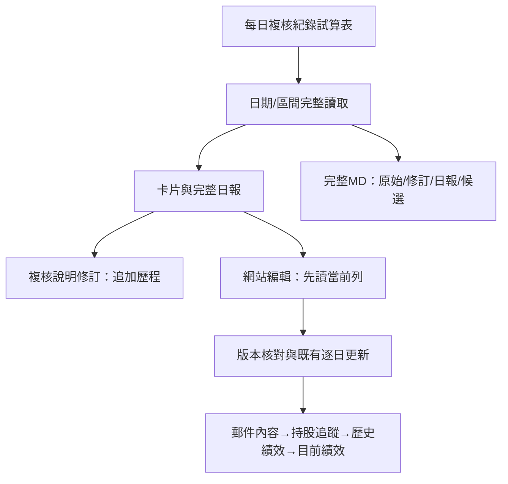

# 複核與修改紀錄

後台登入後選「複核與修改紀錄」。上卡日曆查看單日，下卡可設定起日、迄日或全部；兩端日期都計入。

卡片以紅色明確錯誤、琥珀色待確認、藍色邊界、紫色複核錯區分，搭配文字與符號。手機修正前/後上下排列，電腦左右對照。

## 編輯兩種不同資料

- **編輯複核紀錄**：修訂這筆審閱的名稱、分類、原因、前後文字等，保留原始列及修訂歷程。這個儲存不改網站、不會自動把建議變成程式規則。
- **讀取並編輯網站紀錄**：先讀取當天目前真實股票列，核對整列版本後才套用管理者改動；沿用原逐日編輯的名稱/代號檢查與衍生資料同步。不重新寄Email或LINE。已移除的列不冒充現有列；需要新增請到逐日編輯。

選單保留原值；常用寫法只填草稿，必須依本案原文調整並按儲存才生效。來源或其他管理者已修改時，系統拒絕覆寫，請重新讀取。

## 匯出給其他AI

「匯出完整區間MD」包含選定期間全部原始差異、管理者目前版本、修訂歷程、完整日報及工作流候選。畫面搜尋/嚴重度篩選不縮小匯出範圍；未完整載入不可匯出。

匯出是分析材料，不是標準答案。應讓接收AI依原稿、當時通知與部位另核對，區分複核自身誤判、已套用網站修復及尚未落實的通用流程建議。

