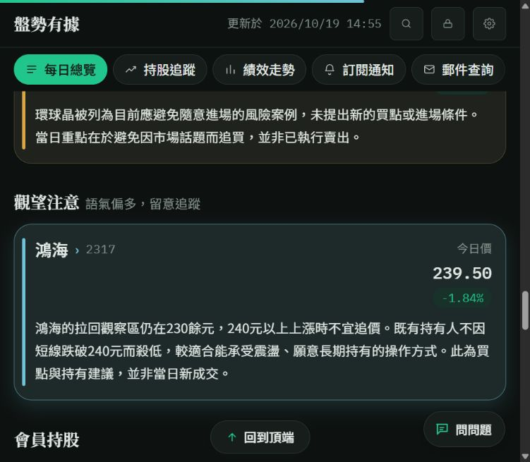

# 來源審核後的正式更新驗收

本階段依管理者「先更新10/19，再處理其他日期」的指示執行。分類答案來自完整原稿的獨立審核；網站只用來讀回結果與鎖定舊列。這裡的修正後符合情形不是模型自行判對率，不能與前階段12次真實重播混成一個提升數字。

## 一、已發布內容

| 日期 | 正式修正 | 寫入與刷新證據 |
|---|---|---|
| 10/19 | 15筆修正：鴻海改注意；補世芯不碰、旭隼與神準持有、環球晶風險；移除毅嘉當日錯位分析；修正其餘說明及數字歸屬 | [首次正式寫入](https://github.com/Lee200202/Stock/actions/runs/39212357800)，三表獨立備份、原子寫入、3步刷新成功 |
| 10/19 | 國巨文字改為正常事實說明，區別511元跌停參考價與當時尚未跌停 | [文字修正](https://github.com/Lee200202/Stock/actions/runs/39212832702)，3步刷新成功 |
| 10/19 | 盤勢3點與教學3點重新整理：首次背離與可能第二次分開、颱風假不當已確認休市、刪宣傳段，補量價與操作風險 | [章節更新](https://github.com/Lee200202/Stock/actions/runs/39213923495)，兩表備份、原稿指紋再核對、郵件查詢刷新成功 |
| 9/22 | 補台達電轉強、漢唐突破季線為注意，聯發科不追高為不碰 | [正式寫入](https://github.com/Lee200202/Stock/actions/runs/39213261128)，三表備份、3步刷新成功；短暫Google404重試後恢復 |
| 9/02 | 補6415矽力的季線壓力；移除誤記在本日的晶心科買入及賣出 | [正式寫入](https://github.com/Lee200202/Stock/actions/runs/39215287447)，3表備份、4步刷新含歷史績效成功；9/01原交易保留 |
| 8/21 | 8筆修正：移除精元、合庫金、立積錯配及身分未定的微星列；補合晶、力積電、聯電風險；陽明歷史出場改回現況觀望 | [正式寫入](https://github.com/Lee200202/Stock/actions/runs/39215933048)，3表備份、4步刷新含歷史績效成功；8/20原出場保留 |

10/19正式讀回為當日買入0、賣出0；當日提及持股8；觀望注意1（鴻海）；觀望不碰5（國巨、聯發科、聯電、世芯-KY、環球晶）。首頁「目前持有」是全部歷史未出場回合，當時為15檔，不能與原稿當日提及8檔直接相比。

亞德客說明已保留年線、400張以上大戶比重約72%至73.6%、低量假跌破與預估EPS50；3,266與未買回屬於相鄰世芯段，已移除。嘉澤保留既有部位續抱，不再掛亞德客的1,200元以下大戶資料。毅嘉只移除本日大盤錯位分析，不取消先前有效持股回合。祥碩在本日的身分線索不足，不強迫新增。

9/01既有晶心科買回及賣出、8/20既有陽明賣出均已另外讀回。修正工具新增前提：更正次日重複誤記的歷史交易時，原事件日須已有對應紀錄，否則停止，避免刪掉唯一交易而改變部位。

## 二、實際驗收面

- 原始試算表：逐欄讀回計畫預期結果；其他日期與不在計畫內的來源列保持原值。歷史來源`MANUAL-日期`需要逐筆明示覆核、舊文字SHA與原因，不能因字串型別或來源名稱就猜是誰加的。
- 發布回應：每次核對寄送旗標與Email／LINE帳本，確認沒有變動。本階段更新不呼叫模型，不寄送，也不重建已寄出的收件匣郵件。
- 公開日期API：10/19、9/22、9/02及8/21已讀回並核對指定分類；機器可讀結果見本目錄`正式讀回.json`，保留實際HTTP／快取狀態。
- 歷史瀏覽器畫面：實際從郵件日曆依序點開9/22、9/02與8/21，確認台達電／漢唐／聯發科、矽力與晶心科持股、合晶／力積電／聯電及陽明歷史出場說明。8/21錯配的精元／合庫金／立積及身分未定微星未再列入分析。
- 首頁：實際開頁，確認觀望注意1、觀望不碰5，鴻海在注意，世芯在不碰。點選10/19日期後，再讀回新說明與8檔當日持股。
- 郵件查詢：實際點進10/19，讀回亞德客、嘉澤、旭隼與神準的新說明；重新開頁後又確認「首次背離／若再下探」與「長期持有、短線交易及借款槓桿」新版盤勢／教學實際顯示，並核對已寄送狀態。原先開著的頁面仍有頁內內容快取，不能把切換分頁當成已重新讀取最新文章。
- 原Apps Script：刷新回應的build為`2026-10-18-usage-analytics-v190r4`。原`/exec`在這個登入帳號的瀏覽器導向Google「找不到網頁」，因此**未宣稱原Web App的UI驗收通過**；這不等於正式API無法讀取。

## 三、寫入防護與過程中發現的問題

1. 先備份，再比對來源及舊資料指紋；修改與修正收據同一Sheets批次寫入。結果未知時不盲重送；再次執行先驗收據與最終狀態，僅接續刷新。
2. `apiSearchByDate`成功不代表首頁或郵件快照同步完成。此次曾先看到新日期資料，但首頁及郵件仍是前一快照；等待對應鍵正常更新後分別核對，沒有全清快取。一次歷史API讀取502保留為過程失敗，後續讀回成功。
3. 9/02及8/21首次預覽因舊來源或說明SHA不符而停止，未寫入。進一步讀回原列，確認公開顯示會整理標點，不能用畫面整理後文字直接當原始儲存值；8/21舊列則是相同日期的手動投稿來源。
4. 新增唯讀inspect模式時，曾把路由放到未設定MODE的離線步驟，導致它誤入一般日期檢查並被30天限制擋下，沒有呼叫模型或寫入。已修正路由，並加入明確允許清單：只有preview、apply、apply-rules、raw可進模型重建；未知模式停止。兩項工作流契約測試覆蓋此事故。
5. 試算表既有動作名為「保留人工說明」，本輪沿用其儲存契約；**本輪內容實際由AI代理完整閱讀原稿後整理，不表示另有管理者逐筆人工核定**。修正計畫及原句供管理者再次查核。
6. 另發現呈現層仍有舊的編輯詞表：例如「屬於摺疊手機題材的觀察標的」可能被當內部分類說明而刪掉。資料表及日期API保留完整句，當前畫面仍保有季線與相對強弱，但少了該題材子句。這個跨GAS與前端的顯示規則缺口另行記錄，**本輪沒有宣稱全站文體詞表已完全移除**；不可只因儲存列正確，就假設所有呈現文字逐字一致。

## 四、離線檢查

- 來源修正工具10項：指紋變動、重複身分、通知保護、明示手動投稿覆核、歷史事件原日存在、保持其他日期、原子收據與最終狀態。
- 工作流路由2項：唯讀模式必須在有MODE的正確步驟執行，未知模式不能進模型重建。
- 來源評分器3項：網站不能補答案、持股／注意等價不擴張為交易、未定不算通過。
- 原公開批次審閱10項與Node發布契約6項通過；本次未修改正式分類程式。
- 更新的3個技能入口驗證通過；20份安裝Markdown與正本一致。手冊5寬度×深淺色、互動、鍵盤、自動播放、減少動態、無JS與零外部網路檢查通過。
- 未完成的全套測試仍依[實測結論](實測結論.md)揭露，不以這些相關檢查宣稱全套通過。

## 五、仍未證明的能力

正式分類／撰稿程式沒有合併跨日倒退的實驗分支；[草稿PR](https://github.com/Lee200202/Stock/pull/2)保留待修。12次真實重播仍有漏收、錯類與跨股引用，不能宣稱未來新稿會自動全對。

本輪完成的是有來源依據的資料修正、發布防護、評估與診斷工具及skills補充。通用流程下一版仍須落實候選處置帳、公司／主體／時間／部位／進場立場分欄、本股主張歸屬及輸入錯句與改寫錯句分開核對；完整標準見[判斷標準與流程缺口](判斷標準與流程缺口.md)。

同模型專案的後續請求仍遵守滾動60秒15RPM（含重試），不額外固定成3RPM。本階段來源修正沒有增加模型請求；前階段12次重播的188次是邏輯呼叫數，不是完整HTTP重試總數。
